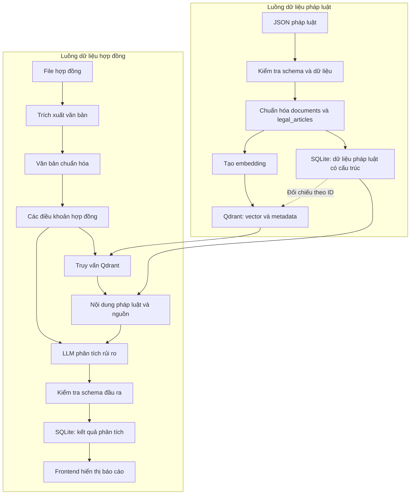

# Luồng dữ liệu hệ thống (Data Flow)

## 1. Mục đích

Tài liệu mô tả cách dữ liệu được tiếp nhận, biến đổi, lưu trữ và trao đổi giữa các mô-đun của ContractRiskAnalyzer.

Tài liệu tập trung vào hai nhóm dữ liệu chính:

1. Dữ liệu pháp luật phục vụ tìm kiếm và truy xuất căn cứ bằng RAG.
2. Dữ liệu hợp đồng và kết quả phân tích rủi ro của người dùng.

## 2. Nguyên tắc thiết kế

- Phân biệt dữ liệu pháp luật, dữ liệu hợp đồng và kết quả phân tích.
- Giữ liên kết từ kết quả phân tích về điều khoản hợp đồng và căn cứ pháp luật nguồn.
- Dữ liệu gốc và dữ liệu đã chuẩn hóa phải có thể phân biệt.
- Dữ liệu được kiểm tra trước khi đưa vào cơ sở dữ liệu hoặc chỉ mục vector.
- Kết quả LLM phải được kiểm tra theo schema trước khi sử dụng.
- Không coi dữ liệu đã được lưu trữ hoặc lập chỉ mục là dữ liệu pháp lý đã được xác minh.
- Việc cập nhật dữ liệu pháp luật phải có cơ chế đồng bộ để tránh truy xuất nội dung lỗi thời.

## 3. Sơ đồ luồng dữ liệu tổng thể



Sơ đồ mô tả luồng logic dự kiến. Việc lưu file gốc, văn bản hợp đồng đã trích xuất và kết quả chi tiết cần được triển khai theo chính sách lưu trữ của hệ thống.

## 4. Luồng dữ liệu pháp luật

### 4.1. Dữ liệu đầu vào

Dữ liệu pháp luật được thu thập và chuẩn hóa thành JSON. Schema hiện tại dự kiến có hai nhóm:

- `documents`: thông tin định danh và metadata của văn bản pháp luật.
- `legal_articles`: nội dung các điều luật, liên kết với văn bản thông qua `doc_id`.

Ví dụ cấu trúc:

```json
{
  "documents": [
    {
      "doc_id": "BO_LUAT_DAN_SU_2015",
      "name": "Bộ luật Dân sự 2015",
      "status": "CON_HIEU_LUC"
    }
  ],
  "legal_articles": [
    {
      "article_id": "BO_LUAT_DAN_SU_2015_DIEU_213",
      "doc_id": "BO_LUAT_DAN_SU_2015",
      "article_number": "Điều 213",
      "full_text": "Nội dung điều luật..."
    }
  ]
}
```

Đây là ví dụ rút gọn. Schema chính thức có thể bổ sung thông tin nguồn, ngày hiệu lực, phiên bản, trạng thái xác minh và các metadata cần thiết khác.

### 4.2. Kiểm tra và chuẩn hóa

Trước khi nạp dữ liệu, hệ thống cần:

- Kiểm tra JSON đúng cú pháp và đúng schema.
- Kiểm tra `doc_id` và `article_id` không bị trùng.
- Kiểm tra mỗi `legal_articles.doc_id` tham chiếu đến một văn bản tồn tại.
- Kiểm tra nội dung điều luật không rỗng và không có lỗi trích xuất nghiêm trọng.
- Kiểm tra nguồn và trạng thái pháp lý theo quy trình xác minh của nhóm.
- Ghi nhận bản ghi lỗi để xử lý, không âm thầm loại bỏ.

Các trường bổ sung cần được thống nhất trước khi triển khai import hàng loạt.

### 4.3. Lưu trữ dữ liệu có cấu trúc

Trong phương án MVP hiện tại, SQLite được dùng để lưu dữ liệu có cấu trúc.

Các bảng dự kiến:

| Bảng | Trách nhiệm |
|---|---|
| `legal_documents` | Thông tin và định danh văn bản pháp luật |
| `legal_articles` | Nội dung điều luật và liên kết đến văn bản |
| `contract_analyses` | Thông tin phiên phân tích hợp đồng |
| `contract_clauses` | Các điều khoản hợp đồng đã trích xuất |
| `risk_results` | Kết quả phân tích của từng điều khoản |
| `risk_evidence` | Liên kết giữa kết quả rủi ro và căn cứ pháp luật |

Đây là thiết kế logic đề xuất; cấu trúc bảng, khóa ngoại và các trường cụ thể sẽ được chốt khi triển khai database.

Không nên lưu toàn bộ thông tin pháp luật, hợp đồng và kết quả phân tích vào một bảng duy nhất, vì các nhóm dữ liệu có quan hệ và vòng đời khác nhau.

### 4.4. Tạo chỉ mục vector

Từ mỗi đơn vị pháp luật đủ điều kiện đưa vào tìm kiếm:

1. Xác định nội dung cần tạo embedding.
2. Gửi nội dung qua embedding model.
3. Tạo vector và lưu vào Qdrant.
4. Gắn ID ổn định cùng metadata cần thiết.
5. Giữ khả năng liên kết vector về bản ghi pháp luật trong SQLite.

Payload tối thiểu dự kiến có:

- `article_id`
- `doc_id`
- `article_number`
- `status` hoặc trạng thái xác minh tương ứng
- `version_id`, nếu quản lý phiên bản
- Metadata phục vụ lọc khi truy xuất

Qdrant không thay thế SQLite làm nơi lưu bản pháp luật có cấu trúc. Vector giúp tìm kiếm; nội dung và thông tin nguồn phải có thể đối chiếu với dữ liệu gốc.

Nếu nhóm dùng `article_id` làm định danh vector, cần bảo đảm ID đó duy nhất trong phạm vi collection. Khi nội dung thay đổi, vector tương ứng phải được cập nhật hoặc loại bỏ theo quy trình đồng bộ.

## 5. Luồng dữ liệu hợp đồng

### 5.1. Dữ liệu đầu vào

Người dùng tải lên tài liệu hợp đồng. Hệ thống tạo `analysis_id` để định danh phiên phân tích và liên kết các dữ liệu phát sinh.

File gốc cần được phân biệt với văn bản trích xuất. Nếu MVP chưa triển khai lưu file trên hệ thống lưu trữ riêng, chính sách lưu file phải được ghi rõ thay vì giả định file đã được lưu an toàn.

### 5.2. Trích xuất và phân tách

Dữ liệu đi qua các bước:

1. File gốc được chuyển đến mô-đun trích xuất.
2. Văn bản được chuẩn hóa và kiểm tra chất lượng.
3. Nội dung được phân tách thành các điều khoản.
4. Mỗi điều khoản có `clause_id`, `analysis_id` và thông tin vị trí nếu xác định được.
5. Nội dung điều khoản được chuyển đến mô-đun phân tích.

Nếu không thể xác định ranh giới điều khoản đáng tin cậy, hệ thống phải ghi nhận giới hạn đó. Không tự tạo vị trí hoặc số điều khoản không có trong tài liệu.

### 5.3. Truy xuất căn cứ pháp luật

Với mỗi điều khoản hợp đồng:

1. Tạo truy vấn từ nội dung điều khoản và ngữ cảnh liên quan.
2. Tạo embedding truy vấn bằng mô hình tương thích với embedding đã lập chỉ mục.
3. Tìm kiếm các vector phù hợp trong Qdrant.
4. Lấy các ID pháp luật tương ứng.
5. Đối chiếu SQLite để lấy nội dung điều luật và metadata nguồn.
6. Kiểm tra trạng thái xác minh và thông tin phiên bản trước khi đưa bằng chứng cho LLM.

Nếu không có kết quả phù hợp, hoặc thông tin nguồn chưa đủ tin cậy, hệ thống phải truyền trạng thái đó vào bước phân tích. Không được tự bổ sung điều luật không có trong kho dữ liệu.

### 5.4. Dữ liệu đầu vào và đầu ra của LLM

Đầu vào gồm:

- Nội dung điều khoản hợp đồng.
- Risk Taxonomy.
- Các bằng chứng pháp luật được truy xuất, nếu có.
- Hướng dẫn phân tích và schema đầu ra.

Đầu ra dự kiến gồm:

- `risk_status`
- `risk_categories`
- `risk_summary`
- `uncertainty_reason`
- `severity`, khi quy tắc xác định mức độ nghiêm trọng đã được thống nhất
- Các tham chiếu đến bằng chứng pháp luật được sử dụng

Sau khi kiểm tra schema và mã taxonomy, backend lưu kết quả vào SQLite. Những kết quả lỗi hoặc chưa hoàn tất cần được phân biệt với kết quả phân tích thành công.

### 5.5. Trả dữ liệu cho giao diện

Frontend nhận báo cáo có cấu trúc từ backend, bao gồm trạng thái phân tích, kết quả từng điều khoản, giải thích và thông tin căn cứ pháp luật.

Frontend không tự kết luận tính hợp pháp dựa trên điểm tương đồng vector. Việc đánh giá rủi ro thuộc về pipeline phân tích và các bước kiểm tra kết quả ở backend.

## 6. Quan hệ giữa các định danh

Các định danh cần thống nhất giữa các mô-đun:

| Định danh | Ý nghĩa |
|---|---|
| `doc_id` | Văn bản pháp luật |
| `article_id` | Điều luật trong văn bản |
| `analysis_id` | Phiên phân tích hợp đồng |
| `clause_id` | Điều khoản hợp đồng được phân tích |
| `risk_result_id` | Kết quả phân tích của điều khoản |
| `evidence_id` | Tham chiếu đến bằng chứng pháp luật |
| `version_id` | Phiên bản văn bản, nếu được triển khai |

Một kết quả rủi ro cần liên kết được với điều khoản hợp đồng đã phân tích. Mỗi bằng chứng pháp luật cần liên kết được với điều luật và văn bản nguồn.

Không nên dùng vị trí của bản ghi trong file JSON làm định danh vì thứ tự có thể thay đổi khi cập nhật dữ liệu.

## 7. Đồng bộ và cập nhật dữ liệu

Khi văn bản pháp luật được cập nhật:

1. Xác định văn bản và các điều luật bị thay đổi.
2. Cập nhật dữ liệu có cấu trúc và thông tin phiên bản trong SQLite.
3. Tạo lại embedding cho các đơn vị có nội dung thay đổi.
4. Cập nhật hoặc loại bỏ vector cũ trong Qdrant.
5. Kiểm tra khả năng truy xuất và liên kết nguồn sau cập nhật.

Quy trình phải tránh tình trạng SQLite chứa nội dung mới trong khi Qdrant vẫn trả về vector của nội dung cũ.

Với MVP, nhóm có thể bắt đầu bằng một script import có khả năng chạy lại an toàn và báo cáo số bản ghi thêm mới, cập nhật, bỏ qua và lỗi. Đồng bộ tự động theo thời gian thực chưa phải yêu cầu bắt buộc.

## 8. Kiểm tra chất lượng dữ liệu

Các kiểm tra tối thiểu:

- Số văn bản và điều luật trước/sau khi import.
- Số bản ghi lỗi, trùng hoặc thiếu quan hệ.
- Khả năng truy ngược từ `article_id` về đúng văn bản.
- Khả năng truy ngược từ kết quả rủi ro về điều khoản hợp đồng và căn cứ pháp luật.
- Khả năng tìm được điều luật liên quan qua bộ câu hỏi kiểm thử.
- Khả năng cập nhật dữ liệu mà không để lại vector lỗi thời.
- Khả năng phân biệt kết quả rủi ro, trường hợp chưa đủ căn cứ và lỗi kỹ thuật.

## 9. Những điểm cần xác nhận khi triển khai

- SQLite có được dùng làm database chính thức của MVP hay chỉ là giải pháp ban đầu.
- Nơi lưu file hợp đồng gốc và thời hạn lưu trữ.
- Schema JSON chính thức và các trường metadata bắt buộc.
- Quy tắc quản lý phiên bản và trạng thái hiệu lực của văn bản pháp luật.
- Embedding model, cấu hình collection và chiến lược tìm kiếm trong Qdrant.
- Cách xử lý cập nhật, xóa dữ liệu và đồng bộ chỉ mục vector.

## 10. Tài liệu liên quan

- `system-architecture.md`: kiến trúc và trách nhiệm các mô-đun.
- `processing-flow.md`: trình tự xử lý hợp đồng.
- `../implementation/README.md`: định hướng triển khai.
