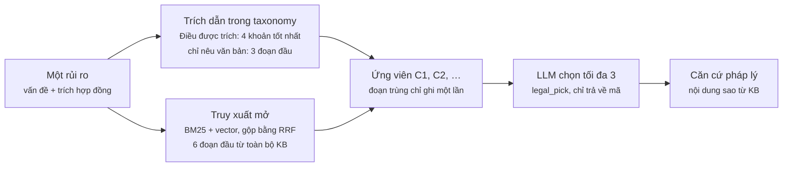

# Cơ sở tri thức pháp lý: thiết kế và triển khai

Cập nhật 2026-11-02.

## Tổng quan

Cơ sở tri thức pháp lý (KB) là kho văn bản quy phạm pháp luật Việt Nam mà hệ thống Contract Risk Analyzer dùng để trích dẫn khi cảnh báo một điều khoản hợp đồng. Mỗi rủi ro được phát hiện đều đi kèm căn cứ là một Điều, khoản cụ thể lấy từ KB, và có thể đối chiếu nguyên văn với văn bản gốc.

KB gồm 15 văn bản, trọng tâm là pháp luật về thuê nhà ở (BLDS 2015, Luật Nhà ở 2023, Luật KDBĐS 2023, NĐ 96/2024), cùng các quy định về thuế, cư trú và hóa đơn mà bên cho thuê phải tuân thủ. Các văn bản được chia thành 5.749 đoạn truy xuất (chunk).

KB có hai kho lưu trữ, dùng chung một bộ mã đoạn:

- **kho quan hệ** (SQLite có chỉ mục toàn văn FTS5): lưu Điều, đoạn và chỉ mục từ khóa BM25;
- **kho vector** (Qdrant): lưu một vector nhúng (embedding) 320 chiều cho mỗi đoạn, phục vụ tìm kiếm theo ngữ nghĩa.

## Nguồn dữ liệu

Kho văn bản gồm 15 tệp văn bản thuần (2,1 MB) trong `data/legal_corpus/`, được commit vào kho mã nên mọi bản clone đều dựng ra cùng một KB. Tổng cộng có 1.292 Điều và 5.749 đoạn. Nguồn gốc từng tệp được ghi trong `data/legal_corpus/SOURCES.md`.

| Văn bản | Lĩnh vực | Số Điều | Số đoạn | Nguồn |
| --- | --- | --- | --- | --- |
| Bộ luật Dân sự 91/2015/QH13 | Thuê nhà (hợp đồng thuê tài sản: Điều 472–482) | 689 | 1.707 | Chưa ghi nhận |
| Luật Nhà ở 27/2023/QH15 | Thuê nhà | 198 | 1.152 | Chưa ghi nhận |
| Luật Kinh doanh bất động sản 29/2023/QH15 | Thuê nhà | 83 | 609 | Chưa ghi nhận |
| NĐ 96/2024/NĐ-CP | Thuê nhà (hướng dẫn Luật KDBĐS) | 40 | 243 | Chưa ghi nhận |
| Phụ lục NĐ 96/2024: mẫu hợp đồng thuê nhà ở | Chỉ tham khảo, không phải quy phạm | 12 | 67 | Chưa ghi nhận |
| Luật Cư trú 68/2020/QH14 | Cư trú | 38 | 226 | ketoananpha.vn |
| Luật Quản lý thuế 108/2025/QH15 | Thuế | 53 | 509 | ketoananpha.vn |
| NĐ 68/2026/NĐ-CP | Thuế (hộ, cá nhân kinh doanh) | 19 | 119 | ketoananpha.vn |
| NĐ 141/2026/NĐ-CP (sửa đổi NĐ 68) | Thuế | 5 | 13 | ketoananpha.vn |
| TT 18/2026/TT-BTC | Thủ tục thuế | 9 | 28 | ketoananpha.vn |
| NĐ 254/2026/NĐ-CP | Hóa đơn điện tử | 45 | 300 | ketoananpha.vn |
| NĐ 125/2020/NĐ-CP | Xử phạt về thuế, hóa đơn | 47 | 288 | Bản scan chính thức, OCR |
| NĐ 310/2025/NĐ-CP (sửa đổi NĐ 125) | Xử phạt về thuế, hóa đơn | 4 | 103 | Bản scan chính thức, OCR |
| NĐ 181/2025/NĐ-CP | Thuế GTGT | 40 | 279 | Bản scan chính thức, OCR |
| TT 20/2026/TT-BTC | Thuế TNDN | 10 | 106 | Bản scan chính thức, OCR |

Văn bản đến từ ba loại nguồn, mỗi loại có một hạn chế đã biết:

- **ketoananpha.vn**, một trang dịch vụ kế toán thương mại, tải ngày 2026-10-16. Phần giao diện trang đã được loại bỏ, nhưng nội dung chưa được đối chiếu với Công báo.
- **Bản scan có chữ ký số** từ vanban.chinhphu.vn. Các bản này không có lớp văn bản nên được đọc bằng một mô hình thị giác chạy cục bộ (Qwen3.5-9B). Vẫn còn một số lỗi OCR.
- **Nhóm văn bản thuê nhà**: nguồn không được ghi lại khi thu thập.

Với cả ba loại, trích dẫn phải được kiểm tra với vbpl.vn hoặc congbao.chinhphu.vn trước khi hiển thị cho người dùng. Các nghị định sửa đổi (NĐ 141, NĐ 310) được lưu thành văn bản riêng, chưa hợp nhất vào văn bản gốc.

Mỗi tệp kết thúc đúng ở Điều cuối cùng. Nơi nhận, chữ ký, dòng thông qua của Quốc hội và các phụ lục đều đã được cắt bỏ (xem mục Hạn chế).

## Mô hình dữ liệu

Một tệp SQLite duy nhất (`backend/cache/legal_kb.db`, 18 MB) lưu văn bản pháp luật ở hai cấp: **Điều** là đơn vị để trích dẫn, còn **đoạn** là đơn vị để tìm kiếm. Bảng thứ ba là bảng ảo FTS5, chỉ mục từ khóa trên các đoạn.

| Bảng | Mỗi dòng là | Các cột | Số dòng |
| --- | --- | --- | --- |
| `articles` | một Điều | `id`, `law` (tên tệp, ví dụ `luat_nha_o_2023`), `dieu_no`, `heading`, `text`, `char_start`, `char_end` | 1.292 |
| `chunks` | một khoản, hoặc một điểm của khoản dài | `id`, `article_id` → `articles.id`, `ref` (`"2"`, `"2.a"`, hoặc `""` nếu là cả Điều), `text` | 5.749 |
| `chunks_fts` | các từ khóa của một đoạn | `rowid` = `chunks.id`, `fts_text` | 5.749 |

Ba lựa chọn thiết kế quan trọng:

- **Đoạn được cắt theo cấu trúc pháp lý, không theo cửa sổ cố định.** Mỗi đoạn là một quy phạm trọn vẹn, thường là một khoản (`1.`, `2.`, …). Khoản dài hơn 550 ký tự được tách tiếp thành từng điểm (`a)`, `b)`, …). Khoản dài mà không có điểm thì giữ nguyên, nên vẫn có đoạn dài tới 1.046 token. Trong 5.749 đoạn có 3.404 khoản, 2.087 điểm và 258 Điều không chia khoản. Một đoạn trung bình dài 319 ký tự; trung vị là 80 token.
- **Mỗi đoạn lặp lại tiêu đề Điều.** Nhờ vậy một kết quả tìm kiếm vẫn mang ngữ cảnh riêng ("Điều 472. Hợp đồng thuê tài sản") ngay cả khi đọc độc lập.
- **Mỗi Điều lưu vị trí ký tự trong tệp nguồn đã chuẩn hóa.** `char_start` và `char_end` cho phép kiểm tra mọi trích dẫn là một lát cắt nguyên văn của văn bản. Bước `kb verify` chạy kiểm tra này sau mỗi lần dựng, và bản hiện tại không có sai lệch nào.

Mã đoạn (chunk id) là khóa nối mọi thứ với nhau: nó là số dòng trong `chunks`, là `rowid` trong chỉ mục FTS, là số hàng trong ma trận vector và là mã điểm (point id) trong Qdrant.

## Quy trình dựng KB

Tệp SQLite không được commit. Mỗi máy tự dựng lại từ kho văn bản bằng một lệnh, `python -m application.modules.legal_retrieval.kb build`, trong vài giây. Quy trình có tính tất định nên mọi bản clone đều có cùng bộ mã đoạn.

1. **Thu thập tệp.** Đọc mọi tệp `.txt` trong `data/legal_corpus/` theo thứ tự tên. Tên văn bản là tên tệp.
2. **Chuẩn hóa.** Chuẩn hóa văn bản bằng cùng hàm `clean()` mà bộ nạp hợp đồng sử dụng, để vị trí ký tự có cùng ý nghĩa ở mọi nơi.
3. **Tách Điều.** Bộ phân tích cấu trúc dùng chung (`ingestion.structure.segment`) tìm từng `Điều N`. Tệp không có Điều nào sẽ làm dừng quá trình dựng.
4. **Chặn phần không phải Điều.** Nếu một Điều chứa dòng "Nơi nhận", chữ ký, dòng thông qua của Quốc hội hay tiêu đề "PHỤ LỤC", quá trình dựng dừng và báo tệp cần sửa.
5. **Tách đoạn.** `khoan_split` cắt mỗi Điều tại các khoản, và tại các điểm nếu khoản dài quá 550 ký tự.
6. **Lập chỉ mục từ khóa.** Mỗi đoạn được tách thành âm tiết viết thường, cộng thêm các cặp âm tiết liền kề như `cho_thuê`, để từ ghép hai âm tiết được khớp như một đơn vị. Kết quả được ghi vào FTS5.
7. **Kiểm tra.** Mỗi Điều đã lưu được so với lát cắt tương ứng của tệp nguồn. Mọi sai lệch đều được báo cáo.

**Dấu vân tay.** `kb_sha` là giá trị băm SHA-256 của toàn bộ nội dung đoạn theo thứ tự mã. Tệp vector ghi lại `kb_sha` của KB dùng để tạo ra nó, và mỗi lần nạp, hệ thống tính lại giá trị này từ KB hiện tại. Nếu kho văn bản thay đổi mà quên tạo lại vector, chương trình dừng với thông báo chỉ rõ cách sửa. Nếu không có kiểm tra này, hàng vector thứ *i* sẽ trỏ sai đoạn và trả về kết quả sai mà không báo lỗi. KB hiện tại có giá trị băm `a3cd7436…d90d`, khớp với bộ vector đã commit.

## Chỉ mục vector

Mỗi đoạn có một vector nhúng 320 chiều từ mô hình `codefuse-ai/F2LLM-v2-80M`. Toàn bộ ma trận có kích thước 5.749 × 320 số float32 (7,4 MB), được commit trong `data/legal_vectors/` cùng tệp siêu dữ liệu `vec_80m.json` (mô hình, số chiều, số hàng, giới hạn token, `kb_sha`). Nhúng toàn bộ kho văn bản mất 86 giây trên CPU, nên việc này chỉ làm lại khi kho văn bản thay đổi, không phải mỗi lần cài đặt.

**Mô hình nhúng.** F2LLM-v2 lấy biểu diễn của token cuối và chuẩn hóa L2, nên tích vô hướng chính là độ tương đồng cosine. Câu truy vấn được thêm tiền tố chỉ dẫn ("Given a question, retrieve passages that can help answer the question"), còn văn bản thì không. Đầu vào giới hạn 2.048 token, đủ cho đoạn dài nhất (1.046 token), nên không đoạn nào bị cắt cụt. Bản thân mô hình nhận được tới 40.960 token.

**Vì sao chọn mô hình 80M.** Trong thử nghiệm ngày 2026-10-16, mô hình này truy xuất tốt gần bằng các mô hình lớn gấp 20 lần, trong khi chạy nhẹ hơn nhiều trên máy chỉ có CPU. Số liệu dưới đây đo trên 27 câu hỏi có đáp án, với một bản KB cũ hơn (5.003 đoạn), nên chênh lệch dưới khoảng 7 điểm là nhiễu.

| Mô hình nhúng | Recall@5 (chỉ vector) | MRR | Thời gian nhúng toàn bộ | Kích thước chỉ mục | Mỗi truy vấn |
| --- | --- | --- | --- | --- | --- |
| F2LLM-v2-80M (đã chọn) | 0,741 | 0,646 | 63 s | 6 MB | 100 ms |
| F2LLM-v2-160M | 0,741 | 0,634 | 95 s | 12 MB | 106 ms |
| F2LLM-v2-0.6B | 0,741 | 0,689 | 552 s | 20 MB | 188 ms |
| F2LLM-v2-1.7B | 0,778 | 0,736 | 1.495 s | 39 MB | 340 ms |

BM25 đơn thuần đạt 0,667, tức vector nhúng cộng thêm khoảng 7 điểm, chủ yếu ở các câu hỏi diễn đạt giống tiêu đề Điều. Kết quả đầy đủ nằm trong `docs/note/legal-retrieval-experiments.md`.

**Kho vector.** Khi chạy, vector được phục vụ bởi Qdrant ở chế độ nhúng (embedded): một thư mục `backend/cache/qdrant`, không cần tiến trình máy chủ. Có một collection `chunks_80m`, dùng khoảng cách cosine. Mã của mỗi điểm là mã đoạn, và payload là tên văn bản, nên tìm kiếm giới hạn trong một văn bản được lọc ngay trong Qdrant. Qdrant chỉ giữ vector: nội dung và vị trí ký tự luôn lấy từ SQLite, nên văn bản pháp luật chỉ có một nguồn duy nhất. Phiên bản đầu dùng tìm kiếm vét cạn bằng numpy; cách này vẫn còn (`DenseRetriever`) và cho cùng kết quả.

**Kiểm tra toàn vẹn.** Khi mở kho, hệ thống so số đoạn trong KB với số điểm trong Qdrant, và so `kb_sha` đã lưu với KB hiện tại. Sai lệch bất kỳ sẽ dừng chương trình kèm thông báo cần chạy lại lệnh nào.

**Trong Docker.** Image dựng KB SQLite và nạp bộ vector đã commit vào Qdrant ngay lúc build, nên container khởi động là dùng được, không cần nhúng gì. Qdrant chế độ nhúng ghi từng điểm xuống đĩa, mất khoảng 20 ms mỗi điểm trên hệ thống tệp của image, tức khoảng 2 phút. Vì vậy bước build ghi collection lên ổ RAM `/dev/shm` rồi sao chép vào, chỉ mất vài giây.

## Truy xuất

KB được truy vấn bởi bước xác định căn cứ pháp lý (`legal_basis/basis.py`). Bước này chạy một lần cho mỗi rủi ro mà bộ phát hiện tìm thấy, và chính mã chương trình quyết định LLM được xem những đoạn nào. LLM chỉ chọn trong số đó, theo mã. Nó không bao giờ tự viết số Điều, nên mọi trích dẫn trong báo cáo đều có nguyên văn trong KB.

**Tìm kiếm kết hợp (hybrid).** Bộ truy xuất mặc định gộp hai bảng xếp hạng bằng phương pháp reciprocal-rank fusion (hằng số 60, lấy 50 kết quả đầu mỗi bên):

- **BM25** trên chỉ mục FTS5, dùng cùng cách tách cặp âm tiết như lúc dựng;
- **tìm kiếm vector** theo cosine trong Qdrant, câu truy vấn được nhúng bằng mô hình 80M.

Cả hai bên trả về cùng một bản ghi `Hit` (mã đoạn, văn bản, Điều, khoản, điểm số, nội dung) qua một giao diện `Retriever` chung. Có thể thay một bên mà không phải sửa nơi gọi. Nếu thiếu torch, Qdrant hay chỉ mục, hệ thống quay về chỉ dùng BM25 và gắn cảnh báo vào kết quả, thay vì báo lỗi.

**Ứng viên cho một rủi ro.** Câu truy vấn là mô tả vấn đề cộng trích đoạn hợp đồng, hoặc mô tả vấn đề cộng tên rủi ro khi hợp đồng thiếu một nội dung. Ứng viên đến từ hai nơi, đoạn trùng chỉ liệt kê một lần:

1. **Trích dẫn trong bộ phân loại rủi ro (taxonomy).** Mỗi loại rủi ro ghi rõ văn bản và Điều điều chỉnh nó. Với một Điều được trích, giữ tối đa 4 khoản, xếp hạng bằng tìm kiếm kết hợp. Với trích dẫn chỉ nêu tên văn bản, giữ 3 đoạn phù hợp nhất trong văn bản đó.
2. **Truy xuất mở.** Thêm 6 đoạn phù hợp nhất từ toàn bộ KB, trừ mẫu hợp đồng thuê nhà vì đó không phải quy phạm.

Sau đó LLM (tác vụ `legal_pick`) nhận danh sách ứng viên đánh mã C1, C2, … và trả về tối đa 3 mã. Mã không có trong danh sách bị loại kèm cảnh báo. Nội dung của mỗi căn cứ pháp lý được sao từ KB, không bao giờ lấy từ câu trả lời của mô hình.

*Truy xuất căn cứ pháp lý cho mỗi rủi ro: mọi trích dẫn đều lấy từ KB, LLM chỉ chọn mã.*

**Tốc độ.** Mô hình nhúng được nạp một lần cho mỗi tiến trình (khoảng 5–6 giây), và API nạp sẵn khi khởi động. Câu truy vấn lặp lại được lưu đệm, vì một rủi ro tìm trên nhiều văn bản với cùng một câu. Việc truy xuất cho từng rủi ro chạy song song với các lượt gọi LLM của những rủi ro trước, nên KB gần như không làm tăng tổng thời gian. Một lượt phân tích trọn vẹn trong container mất 69 giây, phần lớn là thời gian gọi LLM.

## Hạn chế và hướng tiếp theo

Thiết kế lưu trữ phù hợp với quy mô kho văn bản hiện tại. Điểm yếu nằm ở chính các văn bản pháp luật và ở việc chất lượng truy xuất mới được đo rất ít.

| Hạn chế | Ảnh hưởng | Hướng xử lý |
| --- | --- | --- |
| Chưa văn bản nào được đối chiếu với Công báo; các nghị định OCR vẫn còn lỗi | Trích dẫn có thể khác văn bản đang có hiệu lực | Đối chiếu mọi Điều được trích với vbpl.vn trước khi hiển thị cho người dùng |
| Văn bản sửa đổi lưu riêng, chưa áp dụng (NĐ 68/2026 vẫn ghi "500 triệu" dù NĐ 141 đã nâng lên "01 tỷ"; thiếu lần sửa đổi Luật Cư trú năm 2026) | KB có thể trích một con số đã hết hiệu lực | Thêm ngày hiệu lực và liên kết "được sửa đổi bởi" vào bảng `articles`, hoặc lưu văn bản hợp nhất |
| Bộ đánh giá chỉ có 27 câu hỏi có đáp án, một Điều đúng cho mỗi câu | Thứ hạng giữa các mô hình và bộ tách từ nằm trong mức nhiễu | Mở rộng lên ít nhất 40 câu kiểu tiêu đề Điều, cho phép nhiều Điều đúng |
| Bộ tách từ mặc định là `pairs`, trong khi kết hợp với `pyvi` cho kết quả tốt nhất (recall@5 0,889 so với 0,741) | Có thể đang bỏ lỡ vài điểm recall | Xác nhận trên bộ đánh giá lớn hơn, rồi đổi `KB_TOKENIZER` và dựng lại |
| Bộ xếp hạng lại cross-encoder (Qwen3-Reranker-0.6B) đã có nhưng chưa nằm trong luồng mặc định | Vẫn còn một số câu bị bỏ sót (ví dụ C-TRM-02, C-TRM-03) | Đo hiệu quả bộ xếp hạng lại trên 30 kết quả đầu của tìm kiếm kết hợp |
| Qdrant chế độ nhúng khóa thư mục của nó | Mỗi lúc chỉ một tiến trình backend dùng được chỉ mục | Đủ cho bản demo; chuyển Qdrant sang chế độ máy chủ nếu API cần nhiều worker |

**Đã khắc phục ngày 2026-11-02.** Phần văn bản sau Điều cuối cùng (nơi nhận, chữ ký, phụ lục) từng bị lưu như một phần của Điều đó. Trường hợp nặng nhất là phụ lục "Nội dung của hóa đơn" của NĐ 254/2026, dài 21.000 ký tự, đã trở thành 30 đoạn mang nhãn "Điều 45, khoản 1–9", nên một trích dẫn có thể ghi sai số Điều. Các tệp đã được cắt đúng ở Điều cuối (5.779 → 5.749 đoạn), và bước dựng KB nay từ chối Điều nào chứa phần như vậy. Cùng lúc, giới hạn 512 token của mô hình nhúng, vốn không có lý do ghi nhận và đã cắt cụt 12 đoạn, được nâng lên 2.048. Kết quả đánh giá truy xuất không đổi (recall@5 kết hợp 0,704).
