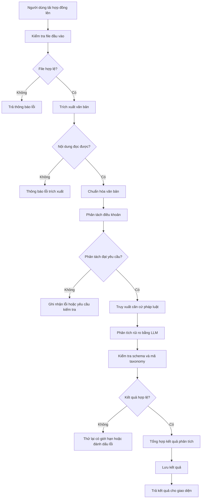

# Luồng xử lý hợp đồng (Processing Flow)

## 1. Mục đích

Tài liệu mô tả trình tự xử lý hợp đồng của ContractRiskAnalyzer, từ khi người dùng cung cấp tài liệu đến khi hệ thống trả kết quả phân tích rủi ro.

Luồng xử lý được thiết kế theo kiến trúc Modular Monolith. Các bước được tổ chức thành các mô-đun trong backend, giao tiếp thông qua các giao diện nội bộ thay vì mặc định triển khai thành các dịch vụ độc lập.

## 2. Phạm vi

Luồng xử lý chính bao gồm:

1. Tiếp nhận và kiểm tra tài liệu.
2. Trích xuất và chuẩn hóa văn bản.
3. Phân tách nội dung thành các điều khoản.
4. Truy xuất căn cứ pháp luật từ kho dữ liệu.
5. Phát hiện và phân loại rủi ro bằng LLM.
6. Kiểm tra kết quả và tổng hợp báo cáo.
7. Lưu trữ kết quả và trả về giao diện người dùng.

Khả năng xử lý PDF scan và ảnh phụ thuộc vào mô hình hoặc công cụ OCR được tích hợp và kết quả kiểm thử trên tài liệu tiếng Việt.

## 3. Sơ đồ luồng xử lý tổng thể

Sơ đồ mô tả luồng logic dự kiến. Chi tiết về số lần thử lại, trạng thái xử lý và cách lưu dữ liệu sẽ được xác định trong quá trình triển khai.

## 4. Mô tả các bước xử lý

### Bước 1. Tiếp nhận và kiểm tra tài liệu

- Nhận file hợp đồng hoặc văn bản được người dùng cung cấp theo định dạng được hỗ trợ.
- Kiểm tra định dạng, dung lượng, số trang nếu áp dụng và khả năng xử lý.
- Tạo mã định danh cho phiên phân tích.
- Ghi nhận trạng thái ban đầu của phiên phân tích.

Nếu file không hợp lệ hoặc vượt giới hạn, hệ thống trả thông báo phù hợp và không tiếp tục phân tích.

### Bước 2. Trích xuất và chuẩn hóa văn bản

Hệ thống lựa chọn phương pháp xử lý theo loại tài liệu:

- **PDF có lớp văn bản và DOCX:** ưu tiên sử dụng thư viện trích xuất văn bản phù hợp.
- **PDF scan hoặc ảnh:** sử dụng OCR hoặc mô hình đa phương thức nếu phương pháp đó đã được tích hợp và kiểm thử.

Sau khi trích xuất, hệ thống chuẩn hóa nội dung ở mức cần thiết, giữ thứ tự đoạn văn và cấu trúc điều/khoản trong phạm vi có thể.

Không tự động tiếp tục phân tích nếu nội dung bị thiếu, không đọc được hoặc có dấu hiệu sai lệch nghiêm trọng. Trường hợp này cần được đánh dấu lỗi hoặc yêu cầu người dùng kiểm tra lại.

### Bước 3. Phân tách điều khoản

- Chia văn bản thành các đơn vị phục vụ phân tích.
- Giữ số điều, khoản, tiêu đề và vị trí trong tài liệu khi xác định được.
- Gắn mã định danh cho từng đơn vị.
- Giữ liên kết giữa điều khoản và tài liệu hợp đồng gốc.

MVP có thể sử dụng quy tắc phân tách dựa trên cấu trúc văn bản. Các trường hợp không có cấu trúc rõ ràng cần được kiểm thử riêng; không mặc định mọi tài liệu đều có thể phân tách chính xác.

### Bước 4. Truy xuất căn cứ pháp luật

Với mỗi điều khoản cần phân tích:

1. Tạo truy vấn từ nội dung điều khoản và thông tin ngữ cảnh cần thiết.
2. Tìm kiếm trong kho dữ liệu pháp luật bằng cơ chế truy xuất phù hợp, bao gồm tìm kiếm vector qua Qdrant.
3. Lấy nội dung pháp luật và metadata tương ứng.
4. Giữ thông tin nguồn, số điều/khoản và định danh văn bản để có thể đối chiếu.

Chỉ sử dụng dữ liệu pháp luật có thể truy ngược về nguồn. Trạng thái hiệu lực phải dựa trên metadata đã xác minh; nếu chưa xác minh được thì phải thể hiện rõ sự không chắc chắn.

Không coi kết quả tìm kiếm tương đồng ngữ nghĩa là bằng chứng pháp lý chắc chắn. Nếu không tìm được căn cứ đủ liên quan, hệ thống phải thể hiện giới hạn này thay vì tự tạo ra trích dẫn.

### Bước 5. Phát hiện và phân loại rủi ro bằng LLM

Đầu vào cho LLM gồm:

- Nội dung điều khoản hợp đồng.
- Risk Taxonomy đã thống nhất.
- Các căn cứ pháp luật được truy xuất, nếu có.
- Hướng dẫn phân tích và schema đầu ra.

LLM được yêu cầu xác định trạng thái rủi ro, phân loại một hoặc nhiều nhóm rủi ro và giải thích ngắn gọn kết quả.

Các trường đầu ra cơ bản:

- `risk_status`: `SAFE`, `RISK` hoặc `UNCERTAIN`.
- `risk_categories`: danh sách mã nhóm rủi ro hợp lệ.
- `risk_summary`: mô tả ngắn gọn dấu hiệu được nhận diện.
- `uncertainty_reason`: lý do chưa thể kết luận, nếu có.

Mức độ nghiêm trọng có thể được biểu diễn bằng `severity`: `LOW`, `MEDIUM`, `HIGH` hoặc `CRITICAL` khi quy tắc đánh giá đã được thống nhất và kiểm thử.

Một điều khoản có thể có nhiều nhóm rủi ro. LLM không được tự tạo mã taxonomy ngoài danh sách đã định nghĩa.

`SAFE` không có nghĩa là bảo đảm điều khoản hoàn toàn hợp pháp trong mọi trường hợp. Kết quả phải được hiểu trong phạm vi thông tin và căn cứ mà hệ thống đã phân tích.

### Bước 6. Kiểm tra kết quả

Backend kiểm tra kết quả LLM theo schema đã định nghĩa:

- Các trường bắt buộc có tồn tại và đúng kiểu dữ liệu.
- `risk_status` thuộc danh sách giá trị cho phép.
- Mọi mã trong `risk_categories` tồn tại trong Risk Taxonomy.
- Các trường giải thích và căn cứ có cấu trúc phù hợp.
- Các trích dẫn pháp luật, nếu có, liên kết được với dữ liệu nguồn.

Nếu kết quả sai định dạng, hệ thống có thể yêu cầu LLM tạo lại kết quả trong số lần giới hạn. Nếu vẫn thất bại, đánh dấu lỗi hoặc trạng thái chưa hoàn tất; không tự chuyển kết quả lỗi thành `SAFE`.

Việc kiểm tra schema không đồng nghĩa với việc xác nhận kết luận pháp lý là đúng. Chất lượng phân tích phải được đánh giá bằng bộ test độc lập.

### Bước 7. Tổng hợp và trả kết quả

Hệ thống tổng hợp kết quả của các điều khoản thành báo cáo hợp đồng, bao gồm:

- Danh sách điều khoản đã phân tích.
- Trạng thái và nhóm rủi ro của từng điều khoản.
- Mức độ nghiêm trọng nếu đã được xác định.
- Giải thích và căn cứ pháp luật liên quan.
- Những trường hợp chưa thể kết luận hoặc xử lý không thành công.

Sau khi lưu kết quả, backend trả dữ liệu có cấu trúc cho frontend để hiển thị. Lỗi ở một điều khoản cần được ghi nhận rõ; hệ thống không được âm thầm coi điều khoản chưa phân tích là an toàn.

## 5. Xử lý lỗi và trạng thái

| Trường hợp | Cách xử lý |
|---|---|
| File sai định dạng hoặc vượt giới hạn | Từ chối xử lý và trả thông báo |
| Không trích xuất được văn bản | Ghi nhận lỗi, yêu cầu người dùng kiểm tra file |
| Văn bản thiếu hoặc không đủ chất lượng | Đánh dấu trạng thái cần kiểm tra; không mặc định tiếp tục |
| Không tìm thấy căn cứ pháp luật phù hợp | Cho phép phân tích với thông tin sẵn có nhưng thể hiện rõ sự không chắc chắn |
| LLM trả kết quả sai schema | Thử lại có giới hạn; sau đó ghi nhận lỗi |
| LLM trả mã taxonomy không hợp lệ | Không chấp nhận kết quả chưa được kiểm tra |
| Lưu dữ liệu thất bại | Ghi nhận lỗi; không thông báo hoàn tất nếu kết quả chưa được lưu theo yêu cầu |
| Một số điều khoản thất bại | Đánh dấu từng điều khoản và trạng thái chung của phiên phân tích |

Các trạng thái kỹ thuật như `PROCESSING`, `COMPLETED`, `PARTIAL_FAILED` hoặc `FAILED` cần được phân biệt với `risk_status` của một điều khoản. Trạng thái kỹ thuật mô tả tiến độ xử lý; trạng thái rủi ro mô tả kết quả phân tích.

## 6. Các điểm cần kiểm chứng trong MVP

- Chất lượng trích xuất tiếng Việt từ PDF và DOCX.
- Khả năng đọc tài liệu scan/ảnh trong giới hạn thời gian và chi phí.
- Độ chính xác khi phân tách điều khoản.
- Chất lượng truy xuất đúng điều luật và nguồn.
- Tính hợp lệ và độ nhất quán của đầu ra LLM.
- Khả năng xử lý trường hợp thiếu căn cứ hoặc chưa đủ thông tin.
- Khả năng lưu và truy xuất lại báo cáo phân tích.

## 7. Tài liệu liên quan

- `system-architecture.md`: kiến trúc tổng thể và trách nhiệm các mô-đun.
- `data-flow.md`: luồng dữ liệu giữa các mô-đun và hệ thống lưu trữ.
- `../implementation/README.md`: định hướng triển khai.
