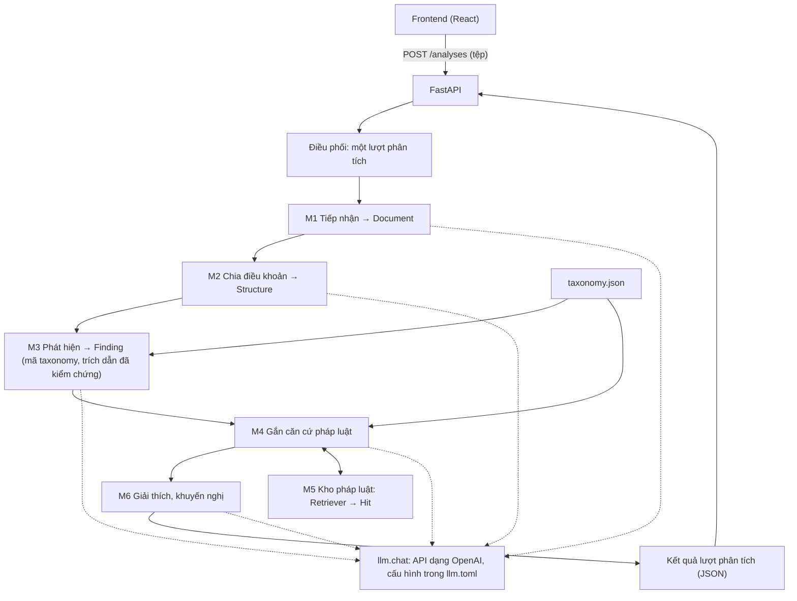

# Đề xuất điều chỉnh kiến trúc ContractRiskAnalyzer

**Trạng thái:** bản đề xuất, chờ nhóm thảo luận và thống nhất.
**Phạm vi:** thay thế `system-architecture.md` sau khi nhóm chốt các đề xuất ở mục 4.

## 1. Vì sao cần đề xuất này

`system-architecture.md` được viết trước khi có mã nguồn. Đến nay mã nguồn đã có M1 (tiếp nhận), M2 (chia điều khoản), M3 (phát hiện rủi ro, bản đầu), M5 (kho pháp luật và truy xuất) cùng các bộ đánh giá đi kèm. Khi triển khai, một số định hướng trong tài liệu cũ không còn phù hợp, và nhiều nội dung trong đó mới dừng ở mức "cần xem xét" mà chưa có quyết định cụ thể.

Đề xuất này nhằm:
- Mô tả kiến trúc bám theo những gì đã xây dựng và đã đo được.
- Nêu rõ những điểm cần nhóm quyết định, kèm phương án đề xuất, lý do và số liệu hiện có.
- Đề xuất cách tổ chức lại tài liệu kiến trúc để mỗi tài liệu trả lời một câu hỏi và trỏ được đến mã nguồn.

Các đề xuất dưới đây đều có thể thay đổi; mục đích là có một bản cụ thể để nhóm góp ý.

## 2. Hiện trạng

| Mô-đun | Nhiệm vụ | Trạng thái | Mã nguồn | Sơ đồ |
|---|---|---|---|---|
| M1 Tiếp nhận | Tệp (txt, docx, doc, pdf, ảnh) → `Document` văn bản sạch | Đã có, có kiểm thử | `backend/application/modules/ingestion/ingest.py`, `vlm.py` | `ingest_top`, `route_pdf` |
| M2 Chia điều khoản | `Document.text` → `Structure` (các `Clause` cấp 1) | Đã có: tầng 1 tất định, tầng 2 dùng LLM khi tầng 1 không chắc chắn | `ingestion/structure.py`, `structure_llm.py` | `m2_top`, `m2_tier1`, `m2_tier2` |
| M3 Phát hiện | `Document` → danh sách `Finding` (mã taxonomy + trích dẫn đã kiểm chứng) | Bản v0: cả hợp đồng trong một lần gọi; cổng kiểm tra trích dẫn; bộ đánh giá | `backend/application/modules/detection/` | `m3_top`, `m3_ground`, `m3_eval`, `m3_plant`, `m3_score` |
| M4 Gắn căn cứ pháp luật | `Finding` → điều luật liên quan | Chưa có | | `m4_legal` |
| M5 Kho pháp luật | Văn bản luật → kho tra cứu; truy vấn → `Hit` | Đã có; đã đo trên 27 câu hỏi | `backend/application/modules/legal_retrieval/` | `m5_build`, `m5_retr`, `m5_eval` |
| M6 Giải thích | Kết quả → giải thích, khuyến nghị cho người dùng | Chưa có | | `m6_explain` |
| Điều phối + API | Nối các mô-đun, lưu kết quả, phục vụ frontend | Chưa có (API mới có `/health`) | `backend/application/main.py` | `orch_api` |
| Taxonomy | `Risk Taxonomy.xlsx` → `taxonomy.json` (77 mã, 7 nhóm); công cụ chạy lại mỗi khi sửa workbook, không chạy trong ứng dụng | Đã có | `backend/application/modules/taxonomy/taxonomy.py` | hướng dẫn: `data/taxonomy/README.md` |
| LLM | Một điểm gọi API dạng OpenAI cho mọi tác vụ | Đã có (OCR đang dùng client riêng) | `backend/application/adapters/llm.py` | `llm_chat` |

Các sơ đồ nằm trong `docs/diagrams/` và thể hiện **kiến trúc đề xuất**. Sơ đồ nào mã hiện tại chưa khớp thì được đánh dấu *(planned)* trong `docs/diagrams/README.md`.

## 3. Kiến trúc đề xuất

### 3.1. Luồng xử lý

Kiểu kiến trúc giữ nguyên như tài liệu cũ: **modular monolith**, một ứng dụng FastAPI, các mô-đun gọi nhau qua kiểu dữ liệu Python. Chi tiết từng bước có trong sơ đồ của từng mô-đun (bảng ở mục 2).

### 3.2. Đầu ra rủi ro là mã taxonomy

Mỗi rủi ro hệ thống báo ra là **một mã trong taxonomy**.
- Mô hình chỉ được chọn trong danh sách mã. Mã không có trong taxonomy thì bị loại.
- Mô hình trả về: mã, trích dẫn nguyên văn và một câu mô tả vấn đề trong hợp đồng cụ thể này.
- Các thông tin sau lấy nguyên từ dòng taxonomy, không do mô hình đánh giá:
  - tên rủi ro;
  - mức độ;
  - bên chịu rủi ro (A = bên cho thuê, B = bên thuê);
  - hậu quả;
  - căn cứ pháp lý đã trích.

### 3.3. Dữ liệu trao đổi giữa các mô-đun

Đề xuất lấy chính các kiểu dữ liệu đã có trong mã làm giao diện chính thức, thay cho các trường dự kiến ở mục 8 tài liệu cũ:

| Kiểu | Tạo bởi | Nội dung chính |
|---|---|---|
| `Document` | M1 | `text` (văn bản sạch, mọi vị trí ký tự đều tính trên đó), `source` (tên tệp, sha256, loại), `pages` (chất lượng từng trang), `warnings` |
| `Structure`, `Clause` | M2 | `layout`; mỗi `Clause` có `label` ("Điều 5"), `heading`, `char_start`, `char_end` |
| `LookFor` | taxonomy (qua `detection/lens.py`) | một mã taxonomy được đưa cho mô hình: `id` (chính là mã, ví dụ `B-DEP-04`), `title`, `signs`, `affects` |
| `Finding` | M3, sau cổng kiểm tra | `code` (mã taxonomy), `kind` (`present`/`missing`), `issue`, `quote`, `char_start`/`char_end`, `clause`; các thông tin còn lại lấy từ dòng taxonomy (mục 3.2) |
| `Hit` | M5 | `law`, `dieu_no`, `ref` (khoản/điểm), `text`, `score` |
| `LegalBasis` (mới) | M4 | `law`, `dieu`, khoản/điểm, `text` (lấy từ kho, không do mô hình viết), `why` (một dòng lý do do mô hình chọn) |
| `Explanation` (mới) | M6 | `summary`, `recommendation` |
| Kết quả lượt phân tích (mới) | Điều phối | tệp `runs/<id>.json`: trạng thái, bước đang chạy, cảnh báo, `Document`, các `Finding` kèm `LegalBasis` và `Explanation`, phiên bản prompt và mô hình (D5) |

Các kiểu mới sẽ được chốt cùng các đề xuất D3, D5 và D7.

### 3.4. Nguyên tắc chung

Các nguyên tắc dưới đây phần lớn đã được áp dụng trong mã hiện tại; đề xuất giữ làm quy ước cho mọi mô-đun:

1. **Mô hình không tự đặt vị trí, nguồn hay phân loại.**
   - Trích dẫn của mô hình phải tìm thấy nguyên văn trong hợp đồng; vị trí ký tự và điều khoản do mã xác định.
   - Mã rủi ro phải có trong taxonomy (mục 3.2).
   - Căn cứ pháp luật chỉ được chọn trong các đoạn luật mà M5 trả về (D3).
2. **Không lặng lẽ tiếp tục khi đầu vào kém.** Trang đọc kém, chia điều khoản không chắc chắn, câu trả lời của mô hình sai định dạng đều để lại cảnh báo trong kết quả.
3. **Mỗi mô-đun có cách đo riêng** và số liệu được ghi lại trong `docs/note/`.

## 4. Các đề xuất cần nhóm quyết định

### D1. Phát hiện rủi ro (M3)

**Đề xuất:**
- Đưa cả hợp đồng vào mô hình cùng danh sách mã taxonomy, thay vì xét từng điều khoản riêng lẻ. Giữ khả năng so sánh với cách từng điều khoản trong bộ đánh giá.
- **Cổng kiểm tra nằm trong M3.** Mỗi `Finding` được kiểm tra ngay sau khi mô hình trả lời:
  - mã có trong taxonomy;
  - với `present`: trích dẫn tìm thấy nguyên văn trong hợp đồng.

  Đặt cổng trong M3 để M3 có thể **gọi lại mô hình** khi có lỗi.
- **Gọi lại khi có lỗi:**
  - Câu trả lời không đọc được (không phải JSON hợp lệ) thì gọi lại.
  - Có `Finding` bị loại thì gửi lại cho mô hình đúng những mục đó, kèm lý do bị loại ("trích dẫn không khớp nguyên văn", "mã không tồn tại"), để mô hình sửa. Các `Finding` hợp lệ được giữ nguyên.
  - Tối đa 2 lần gọi lại. Sau đó, phần vẫn bị loại được ghi vào cảnh báo.
  - Mọi lần gọi đều được ghi lại trong kết quả lượt phân tích, để đối chiếu khi đánh giá.

**Lý do:**
- Hợp đồng thuê nhà ngắn (trung vị khoảng 2.700 token), vừa trọn trong một lần gọi.
- Nhiều rủi ro chỉ thấy được khi đọc nhiều điều cùng lúc: điều khoản mâu thuẫn nhau, nội dung bị thiếu. Cách từng điều khoản không phát hiện được các trường hợp này.
- Mô hình đôi khi chép trích dẫn không chính xác (sửa chữ, tóm tắt). Gọi lại có kèm lý do thường sửa được mà không mất kết quả.

**Cần chốt thêm:** đưa cả 77 mã vào một lần gọi, hay gọi riêng cho từng nhóm (7 nhóm, mỗi lần một danh sách ngắn hơn và chi tiết hơn). Đề xuất đo cả hai trên bộ đánh giá.

**Chưa chắc chắn:** mới chạy thử trên một hợp đồng có chèn rủi ro. Kết quả: phát hiện 6/6 rủi ro được chèn, nhưng 0/4 rủi ro vốn có sẵn trong mẫu. Cần thêm hợp đồng gold trước khi coi là kết luận.

**Sơ đồ:** `m3_top` (gồm vòng gọi lại), `m3_ground` (cổng kiểm tra), `m3_eval`, `m3_plant`, `m3_score` (bộ đánh giá).

### D2. Nội dung bị thiếu trong hợp đồng

**Đề xuất:** "thiếu" chỉ được báo với những mã taxonomy mô tả sự vắng mặt của một nội dung (ví dụ các dòng dạng "không quy định…"). Mô hình không được báo thiếu một nội dung tùy ý.

**Cho MVP:** các `missing` vẫn hiển thị, kèm ghi chú cần người dùng tự kiểm tra lại.

**Sau MVP:**
- Đánh dấu trong taxonomy những mã thuộc loại "thiếu", kèm điều kiện áp dụng (ví dụ: chỉ hỏi về hoàn cọc khi hợp đồng có đặt cọc).
- Đối chiếu với Luật Nhà ở 2023 Điều 163 và mẫu hợp đồng phụ lục 2 NĐ 96/2024. Nội dung bắt buộc nào chưa có mã thì đề xuất nhóm dữ liệu bổ sung mã.

**Lý do:** lỗi chính của loại này là báo "thiếu" sai do mô hình bỏ sót điều khoản có thật. Trong lần chạy thử, mô hình cũng bỏ sót một nội dung bị xóa có chủ đích (ngày bàn giao).

### D3. Gắn căn cứ pháp luật (M4)

**Đề xuất:**
1. Mỗi `Finding` đều có mã taxonomy (mục 3.2), nên luôn dùng trước các điều luật mà dòng taxonomy đó trích dẫn. Các trích dẫn này đã được quy về mã văn bản trong kho.
2. Đồng thời truy xuất bằng M5 với truy vấn tạo từ `issue` và trích dẫn hợp đồng.
3. Mô hình chọn căn cứ phù hợp **chỉ trong số các đoạn được đưa vào**, trả về mã đoạn. Mã sẽ kiểm tra mã đoạn đó có tồn tại.
4. Không tìm được căn cứ phù hợp thì ghi rõ "chưa tìm thấy căn cứ", không để mô hình tự viết số điều luật.

**Chi tiết:**
- Truy vấn cho M5: với `present`, ghép mô tả vấn đề và trích dẫn hợp đồng. Với `missing` (không có trích dẫn), dùng tên rủi ro thay cho trích dẫn.
- Trích dẫn trong taxonomy có tên luật chưa có trong kho thì bỏ qua, kèm cảnh báo.
- Bước chọn căn cứ là một tác vụ LLM riêng (`legal_pick`). Mã đoạn mô hình trả về không có trong danh sách ứng viên thì bị bỏ, kèm cảnh báo.

**Cần làm trước:** sửa trích dẫn trong taxonomy. Bản rà soát `docs/note/taxonomy-citation-review.md` (70 mã, ngày 16/10) ghi nhận 26 mã có trích dẫn sai, thiếu số điều hoặc chưa kiểm tra. 7 mã thêm sau đó chưa được rà soát.

**Sơ đồ:** `m4_legal`.

### D4. Gọi mô hình qua API

**Đề xuất:**
- Mọi tác vụ LLM gọi qua một API dạng OpenAI (`/chat/completions`). Nhà cung cấp, mô hình và khóa API khai báo trong `backend/llm.toml` (không đưa lên git), đổi nhà cung cấp chỉ cần sửa cấu hình.
- Gộp OCR (`ingestion/vlm.py`, đang dùng biến môi trường riêng) vào cùng cấu hình này, thành tác vụ `vision`.
- Bỏ ràng buộc "chỉ gửi đến máy cục bộ" trong `llm.py`. Cấu hình máy chủ cục bộ (llama-server) giữ lại dưới dạng ví dụ.
- Không có tệp cấu hình thì báo lỗi rõ ràng (hướng dẫn chép `llm.example.toml` thành `llm.toml`), thay vì mặc định gọi máy chủ cục bộ.
- Các tác vụ: `structure_fallback` (M2), `vision` (OCR, M1), `detect` (M3), `legal_pick` (M4), `explain` (M6). Mỗi tác vụ có thể dùng mô hình khác nhau.

**Lý do:**
- Triển khai và chạy thử không phụ thuộc GPU của một thành viên.
- Giảng viên không yêu cầu bắt buộc chạy mô hình cục bộ.

**Lưu ý:** dữ liệu thử nghiệm hiện là hợp đồng mẫu. Khi có người dùng thật, nội dung hợp đồng họ tải lên sẽ được gửi đến nhà cung cấp API. Cần ghi điều này trong phần thông tin cho người dùng (xem mục 10 tài liệu cũ).

**Sơ đồ:** `llm_chat`.

### D5. Lưu kết quả phân tích

**Đề xuất cho MVP:**
- Chưa dùng PostgreSQL. Mỗi lượt phân tích lưu thành một tệp `runs/<id>.json`, gồm: trạng thái và bước đang chạy, cảnh báo, `Document`, các `Finding`, căn cứ, giải thích, và phiên bản prompt/mô hình đã dùng.
- Tệp được ghi lại sau mỗi bước, nên frontend thấy được tiến độ và lượt bị lỗi vẫn giữ kết quả các bước trước.
- Chuyển sang SQLite khi cần tài khoản người dùng hoặc tra cứu lịch sử.

**Lý do:** MVP chưa có yêu cầu về người dùng hay truy vấn chéo giữa các lượt. Lưu JSON vừa đủ để hiển thị lại kết quả và để đối chiếu khi đánh giá.

### D6. API và điều phối

**Đề xuất:**
- `POST /analyses` nhận tệp, trả ngay mã lượt phân tích.
- Việc phân tích chạy nền trong cùng tiến trình (FastAPI background task, chưa cần hàng đợi riêng).
- `GET /analyses/{id}` trả trạng thái (`queued`, `running` kèm bước đang chạy, `done`, `failed`) cùng kết quả hoặc lỗi. Frontend gọi lại định kỳ cho đến khi xong.
- Lượt phân tích chuyển sang `failed`, kèm mã và thông báo lỗi, khi:
  - gặp lỗi tiếp nhận (`IngestError`, có mã lỗi);
  - hoặc bước phát hiện vẫn lỗi sau khi đã gọi lại (D1).

**Lý do:** một lượt có thể mất từ vài chục giây đến vài phút (OCR từng trang, lời gọi phát hiện, gắn căn cứ), không nên giữ kết nối HTTP chờ.

**Sơ đồ:** `orch_api` (bao gồm cả D5).

### D7. Giải thích và khuyến nghị (M6)

**Đề xuất:**
- Với mỗi `Finding`, mô hình viết bằng tiếng Việt dễ hiểu:
  - điều khoản này có ý nghĩa gì;
  - vì sao gây rủi ro cho bên liên quan;
  - nên hỏi lại hoặc sửa gì trước khi ký.
- Đầu vào gồm `Finding`, dòng taxonomy và danh sách `LegalBasis` từ M4.
- Giải thích chỉ được nhắc đến những điều luật có trong danh sách `LegalBasis`. Nếu nhắc điều luật khác, giải thích bị bỏ, kèm cảnh báo. Kết quả vẫn hiển thị với tên, mức độ và hậu quả lấy từ taxonomy.

**Cần chốt thêm:**
- Gọi mô hình riêng cho từng `Finding`, hay một lần cho cả kết quả (ít lời gọi hơn, nhưng câu trả lời dài hơn và khó kiểm tra hơn).
- Giải thích có nhắc lại phần "hậu quả" của taxonomy không, hay chỉ bổ sung phần riêng cho hợp đồng này.

**Sơ đồ:** `m6_explain`.

## 5. Đề xuất tổ chức lại tài liệu

Sau khi nhóm thống nhất mục 4:

| Tài liệu | Nội dung |
|---|---|
| `architecture/overview.md` | Sơ đồ tổng thể, bảng mô-đun, kiểu dữ liệu trao đổi, những gì đã có và chưa có (thay `system-architecture.md`) |
| `architecture/<mô-đun>.md` | Mỗi mô-đun một trang: nhiệm vụ, đầu vào/ra, cách hoạt động (dùng sơ đồ trong `docs/diagrams/`), cách đánh giá, vị trí mã nguồn |
| `architecture/evaluation.md` | Cách đo từng mô-đun, dẫn đến các ghi chú thử nghiệm |
| `decisions/NNN-*.md` | Mỗi quyết định D1–D7 một trang ngắn: bối cảnh, phương án, quyết định, căn cứ |
| `api.md` | Các endpoint ở D6 và định dạng kết quả |

`processing-flow.md` và `data-flow.md` (đã có nội dung trên `main`) cần được đối chiếu với đề xuất này; phần còn phù hợp chuyển vào `overview.md` và các trang mô-đun. `implementation/README.md` chỉ giữ phần quy trình làm việc của nhóm.

## 6. Bước tiếp theo đề xuất

1. Nhóm góp ý và chốt D1–D7. Mỗi đề xuất có thể được chấp nhận, sửa đổi hoặc để mở kèm việc cần kiểm chứng.
2. Viết lại tài liệu theo mục 5.
3. Điều chỉnh mã theo các quyết định, bắt đầu từ D4 (cấu hình LLM qua API), sau đó đến khung điều phối và API (D5, D6).
4. Mở rộng bộ đánh giá phát hiện để kiểm chứng D1: thêm hợp đồng gold, rủi ro chèn khó hơn, gắn mã taxonomy vào gold.
5. Nhóm dữ liệu rà soát lại taxonomy: sửa trích dẫn, gộp các dòng trùng (ví dụ A-AUT-05 và B-AUT-05), làm rõ "dấu hiệu nhận biết" để mô hình phân biệt được các mã gần nhau. Vì đầu ra chỉ gồm mã taxonomy, taxonomy quyết định trực tiếp phạm vi những gì hệ thống báo được.
