# Kiến trúc hệ thống ContractRiskAnalyzer

## 1. Mục đích tài liệu

Tài liệu mô tả kiến trúc tổng thể của ContractRiskAnalyzer, một hệ thống hỗ trợ phân tích rủi ro trong hợp đồng thuê nhà/phòng tại Việt Nam.

Các mục tiêu của tài liệu:
- Xác định các thành phần chính và trách nhiệm của từng thành phần.
- Mô tả mối quan hệ giữa giao diện người dùng, backend, các mô-đun phân tích và hệ thống lưu trữ.
- Làm cơ sở để thiết kế luồng xử lý hợp đồng, luồng dữ liệu và giao diện giữa các mô-đun.
- Hỗ trợ phân công công việc và tích hợp các phần được phát triển song song.
- Phân biệt các quyết định đã thống nhất với những nội dung cần thử nghiệm hoặc xác nhận thêm.

Tài liệu này mô tả kiến trúc logic dự kiến, không khẳng định tất cả thành phần đã được triển khai hoàn chỉnh.

## 2. Phạm vi hệ thống

Hệ thống hướng đến việc hỗ trợ người dùng nhận diện và hiểu các dấu hiệu rủi ro trong hợp đồng thuê nhà/phòng.

Các chức năng chính dự kiến:
1. Tiếp nhận tài liệu hợp đồng.
2. Trích xuất và chuẩn hóa nội dung hợp đồng.
3. Chia nội dung thành các điều khoản phục vụ phân tích.
4. Phát hiện trạng thái rủi ro của từng điều khoản.
5. Phân loại điều khoản theo Risk Taxonomy.
6. Đánh giá mức độ nghiêm trọng của rủi ro.
7. Truy xuất căn cứ pháp luật liên quan.
8. Tạo giải thích và khuyến nghị cho người dùng.
9. Lưu trữ và hiển thị kết quả phân tích.

Hệ thống có vai trò hỗ trợ tham khảo, không thay thế tư vấn của luật sư hoặc kết luận pháp lý có thẩm quyền.

## 3. Trạng thái các quyết định kiến trúc

| Nội dung | Trạng thái | Ghi chú |
|---|---|---|
| Kiến trúc tổng thể | Đã thống nhất định hướng | Modular Monolith |
| Backend | Đã chọn | FastAPI |
| Frontend | Đã chọn | React, TypeScript và Vite |
| Xử lý tài liệu | Đã thống nhất định hướng | Kết hợp trích xuất văn bản trực tiếp với OCR hoặc LLM đa phương thức |
| Phân tích rủi ro | Đã thống nhất định hướng | LLM theo prompt và schema thống nhất |
| Lưu trữ | Đã thống nhất định hướng | PostgreSQL kết hợp Qdrant |
| Schema cơ sở dữ liệu | Cần thiết kế | Chưa chốt đầy đủ các bảng và quan hệ |
| Lựa chọn OCR hoặc mô hình đa phương thức | Cần kiểm chứng | So sánh chất lượng, chi phí và thời gian xử lý |
| Mô hình embedding và cách chia đoạn pháp luật | Cần thử nghiệm | Ảnh hưởng trực tiếp đến chất lượng truy xuất |
| Cơ chế kiểm tra căn cứ pháp lý | Cần thiết kế chi tiết | Phải bảo đảm khả năng truy xuất nguồn và hạn chế nhận định thiếu căn cứ |
| Hiệu năng và giới hạn tài liệu | Cần kiểm chứng | Xác định qua thử nghiệm thực tế |

Các trạng thái trên cần được cập nhật khi nhóm có kết quả triển khai hoặc quyết định mới.

## 4. Kiểu kiến trúc

Hệ thống sử dụng kiến trúc **Modular Monolith**.

Backend được tổ chức thành các mô-đun có trách nhiệm riêng nhưng cùng thuộc một ứng dụng backend. Các mô-đun giao tiếp thông qua giao diện nội bộ được thống nhất, thay vì triển khai thành nhiều microservice độc lập.

### Lý do lựa chọn

- Phù hợp với quy mô nhóm và thời gian phát triển MVP.
- Giảm độ phức tạp khi triển khai, chạy thử và tích hợp.
- Cho phép các thành viên phát triển những mô-đun khác nhau song song.
- Dễ thay đổi cách triển khai một mô-đun mà không phải thiết kế lại toàn bộ hệ thống.

Việc chia thành mô-đun logic không đồng nghĩa với việc mỗi mô-đun phải có máy chủ hoặc dịch vụ riêng.

## 5. Sơ đồ kiến trúc tổng thể

```mermaid
flowchart TB
    U[Người dùng]
    FE[Frontend<br/>React + TypeScript + Vite]
    API[Backend API<br/>FastAPI]

    subgraph APP[Backend - Modular Monolith]
        ING[Tiếp nhận hợp đồng]
        PARSE[Trích xuất và chuẩn hóa văn bản]
        SEG[Chia điều khoản]
        RISK[Phát hiện và phân loại rủi ro]
        SEV[Đánh giá mức độ nghiêm trọng]
        RET[Truy xuất căn cứ pháp luật]
        EVID[Kiểm tra căn cứ]
        EXPL[Giải thích và khuyến nghị]
        ORCH[Điều phối quy trình phân tích]
    end

    subgraph STORAGE[Hệ thống lưu trữ]
        PG[(PostgreSQL)]
        QD[(Qdrant)]
        FILE[(Tệp hợp đồng<br/>hoặc vùng lưu tệp)]
    end

    LLM[LLM Adapter<br/>Giao diện tích hợp mô hình]
    EXTLLM[LLM / Mô hình đa phương thức]
    EMB[Embedding Model]
    LEGAL[Kho văn bản pháp luật đã chuẩn hóa]

    U <--> FE
    FE <--> API
    API --> ORCH

    ORCH --> ING
    ING --> PARSE
    PARSE --> SEG
    SEG --> RISK
    RISK --> SEV
    RISK --> RET
    RET --> EVID
    EVID --> EXPL

    PARSE --> LLM
    RISK --> LLM
    SEV --> LLM
    EXPL --> LLM
    LLM <--> EXTLLM

    RET --> PG
    RET --> QD
    LEGAL --> PG
    LEGAL --> EMB
    EMB --> QD

    ORCH <--> PG
    ING --> FILE
    EXPL --> ORCH
```

**Lưu ý:** Sơ đồ biểu diễn các thành phần logic và các quan hệ chính. Khi triển khai, luồng thực tế có thể cần điều chỉnh. Đặc biệt, bước đánh giá mức độ nghiêm trọng và cách kết hợp truy xuất pháp luật với phân tích rủi ro cần được xác nhận trong tài liệu luồng xử lý.

## 6. Trách nhiệm của các thành phần

### 6.1. Frontend

**Công nghệ:** React, TypeScript, Vite.

Trách nhiệm:
- Cho phép người dùng tải lên hợp đồng.
- Gửi yêu cầu phân tích đến backend.
- Hiển thị trạng thái xử lý và thông báo lỗi.
- Hiển thị danh sách điều khoản, trạng thái rủi ro, nhóm rủi ro, mức độ nghiêm trọng và căn cứ pháp luật khi có.
- Cho phép người dùng xem chi tiết kết quả.

Frontend không tự đưa ra kết luận rủi ro pháp lý. Các kết quả phân tích do backend trả về.

### 6.2. Backend API

**Công nghệ:** FastAPI.

Trách nhiệm:
- Tiếp nhận và kiểm tra yêu cầu từ frontend.
- Kiểm tra loại tệp, kích thước và các điều kiện xử lý.
- Điều phối các mô-đun theo quy trình phân tích.
- Kiểm tra cấu trúc dữ liệu đầu vào và đầu ra.
- Lưu kết quả và cung cấp API để truy vấn trạng thái, kết quả phân tích.

API không nên chứa toàn bộ logic nghiệp vụ trong một tệp hoặc một endpoint duy nhất.

### 6.3. Mô-đun tiếp nhận và trích xuất hợp đồng

Trách nhiệm:
- Tiếp nhận tệp hợp đồng.
- Nhận diện loại tài liệu và lựa chọn phương thức trích xuất.
- Trích xuất trực tiếp văn bản từ các tệp có lớp văn bản khi phù hợp.
- Sử dụng OCR hoặc LLM đa phương thức cho tài liệu scan và ảnh khi cần.
- Chuẩn hóa nội dung và giữ thông tin vị trí trong tài liệu ở mức có thể.
- Phát hiện trường hợp không đọc được, thiếu trang hoặc kết quả trích xuất không đáng tin cậy.

**Cần kiểm chứng:** thư viện trích xuất, OCR hoặc mô hình đa phương thức cụ thể; giới hạn kích thước và số trang; chất lượng với tài liệu tiếng Việt.

Nếu nội dung không đủ tin cậy, hệ thống phải thông báo hoặc yêu cầu người dùng kiểm tra thay vì âm thầm tiếp tục như thể tài liệu đã được đọc chính xác.

### 6.4. Mô-đun chia điều khoản

Trách nhiệm:
- Chia nội dung hợp đồng thành các điều, khoản hoặc đơn vị phân tích phù hợp.
- Gán mã định danh cho từng đơn vị.
- Lưu vị trí nguồn để có thể đối chiếu kết quả với hợp đồng ban đầu.
- Giữ nội dung gốc để phục vụ kiểm tra và hiển thị.

**Cần kiểm chứng:** phương pháp chia theo cấu trúc, cách xử lý hợp đồng không có định dạng chuẩn và cách xử lý điều khoản dài hoặc lồng nhau.

### 6.5. Mô-đun phân tích rủi ro

Mô-đun này sử dụng LLM thông qua một giao diện tích hợp thống nhất.

Trách nhiệm:
- Nhận nội dung điều khoản và Risk Taxonomy.
- Phát hiện trạng thái rủi ro.
- Gán một hoặc nhiều nhóm rủi ro phù hợp.
- Đánh giá mức độ nghiêm trọng theo quy tắc đã thống nhất.
- Trả kết quả theo schema quy định.
- Biểu diễn rõ trường hợp chưa đủ thông tin để kết luận.

Định hướng đầu ra:
- `risk_status`: `SAFE`, `RISK` hoặc `UNCERTAIN`.
- `risk_categories`: danh sách mã nhóm rủi ro hợp lệ.
- `severity`: mức độ nghiêm trọng theo taxonomy hoặc quy tắc đã thống nhất.
- `risk_summary`: mô tả ngắn gọn dấu hiệu rủi ro.
- `uncertainty_reason`: lý do chưa thể kết luận, nếu có.

Cần xác định rõ trường hợp không có nhóm rủi ro phù hợp, cách kiểm tra giá trị đầu ra và mối quan hệ giữa trạng thái rủi ro với mức độ nghiêm trọng.

Không mặc định mọi kết quả do LLM tạo ra đều chính xác. Chất lượng cần được đo trên tập kiểm thử độc lập.

### 6.6. Mô-đun truy xuất pháp luật

Trách nhiệm:
- Tiếp nhận truy vấn từ điều khoản hoặc kết quả phân tích.
- Tìm các đoạn văn bản pháp luật liên quan.
- Trả về nội dung, nguồn và thông tin vị trí của văn bản.
- Hỗ trợ mô-đun kiểm tra căn cứ và giải thích kết quả.

Nguồn truy xuất dự kiến gồm kho văn bản pháp luật đã chuẩn hóa và chỉ mục vector trong Qdrant.

**Cần kiểm chứng:** chiến lược chia đoạn, mô hình embedding, tìm kiếm từ khóa kết hợp vector và tiêu chí xác định căn cứ phù hợp.

### 6.7. Mô-đun kiểm tra căn cứ và giải thích

Trách nhiệm:
- Đối chiếu nhận định rủi ro với căn cứ truy xuất được.
- Kiểm tra khả năng liên hệ giữa điều khoản và đoạn văn bản pháp luật.
- Phát hiện trường hợp không có căn cứ đủ phù hợp hoặc có thông tin mâu thuẫn.
- Tạo giải thích và khuyến nghị có thể đối chiếu với nguồn.
- Biểu diễn rõ mức độ không chắc chắn.

Không được tự tạo số hiệu điều luật, trích dẫn hoặc nội dung pháp lý khi không có căn cứ trong dữ liệu truy xuất.

### 6.8. Mô-đun điều phối quy trình

Trách nhiệm:
- Điều phối thứ tự thực thi các mô-đun.
- Quản lý trạng thái xử lý của một phiên phân tích.
- Thu thập kết quả trung gian và tổng hợp kết quả cuối.
- Xử lý lỗi và trạng thái không thể tiếp tục phân tích.
- Ghi nhận các thông tin cần thiết để theo dõi và kiểm tra.

Mô-đun điều phối có thể được triển khai như một lớp nghiệp vụ bên trong backend, không phải dịch vụ riêng.

## 7. Thiết kế lưu trữ

### 7.1. PostgreSQL

PostgreSQL dự kiến lưu dữ liệu nghiệp vụ có cấu trúc, bao gồm:
- Phiên phân tích và trạng thái xử lý.
- Thông tin tài liệu hợp đồng.
- Các điều khoản được trích xuất.
- Kết quả phân tích và phân loại rủi ro.
- Thông tin liên kết đến các căn cứ pháp luật được sử dụng.
- Metadata của tài liệu pháp luật và các đoạn văn bản đã chuẩn hóa, nếu phù hợp với schema cuối cùng.

Schema chi tiết, quan hệ giữa các bảng và chính sách lưu trữ sẽ được xác định trong tài liệu thiết kế cơ sở dữ liệu.

### 7.2. Qdrant

Qdrant dự kiến lưu vector embedding của các đoạn văn bản pháp luật cùng metadata cần thiết để truy xuất.

Các trường metadata có thể gồm:
- Mã đoạn văn bản.
- Mã văn bản pháp luật.
- Điều, khoản hoặc điểm.
- Trạng thái hiệu lực hoặc thông tin phiên bản phù hợp.
- Thông tin liên kết về nguồn.

Qdrant phục vụ tìm kiếm vector; không mặc định là nơi lưu trữ duy nhất của văn bản pháp luật gốc.

### 7.3. Tệp hợp đồng

Tệp hợp đồng gốc có thể được lưu trong vùng lưu trữ tệp riêng hoặc theo cơ chế phù hợp với môi trường triển khai. PostgreSQL lưu metadata và thông tin tham chiếu đến tệp.

**Cần kiểm chứng:** vị trí lưu tệp, thời gian lưu giữ, cách kiểm soát quyền truy cập và cách xử lý dữ liệu hợp đồng nhạy cảm.

### 7.4. Nguyên tắc đồng bộ dữ liệu

Mã định danh giữa PostgreSQL và Qdrant phải cho phép truy xuất về cùng một văn bản hoặc đoạn văn bản. Khi cập nhật hoặc loại bỏ dữ liệu pháp luật, cần có cơ chế cập nhật chỉ mục tương ứng để tránh truy xuất dữ liệu cũ hoặc không còn phù hợp.

## 8. Giao diện giữa các mô-đun

Các mô-đun cần thống nhất cấu trúc dữ liệu trước khi phát triển song song.

Ví dụ, đầu ra của mô-đun chia điều khoản có thể chứa:
- `clause_id`: mã định danh điều khoản.
- `document_id`: mã tài liệu nguồn.
- `clause_text`: nội dung điều khoản.
- `source_location`: vị trí trong tài liệu gốc, nếu xác định được.

Đầu ra của mô-đun phân tích rủi ro có thể chứa:
- `clause_id`.
- `risk_status`.
- `risk_categories`.
- `severity`.
- `risk_summary`.
- `uncertainty_reason`.

Đầu ra truy xuất pháp luật cần chứa mã văn bản, vị trí điều khoản pháp luật, nội dung trích dẫn và nguồn.

Các tên trường trên là đề xuất ban đầu. Schema chính thức phải được thống nhất trong tài liệu API hoặc schema dùng chung trước khi tích hợp.

## 9. Nguyên tắc xử lý lỗi và độ tin cậy

Hệ thống cần xử lý tối thiểu các tình huống:
- Tệp không được hỗ trợ hoặc vượt giới hạn cho phép.
- Không trích xuất được văn bản đáng tin cậy.
- Không chia được điều khoản hợp lý.
- LLM trả về dữ liệu sai schema hoặc mã Risk Taxonomy không hợp lệ.
- Không tìm được căn cứ pháp luật phù hợp.
- Lỗi kết nối đến mô hình hoặc hệ thống lưu trữ.
- Không thể hoàn thành một phiên phân tích.

Mỗi lỗi cần có trạng thái và thông báo phù hợp. Không nên chuyển lỗi kỹ thuật thành kết quả `SAFE` hoặc trình bày trường hợp thiếu căn cứ như một kết luận pháp lý chắc chắn.

## 10. Bảo mật và quản lý dữ liệu

Hợp đồng có thể chứa thông tin cá nhân hoặc thông tin riêng tư. Vì vậy, hệ thống cần xem xét:
- Hạn chế quyền truy cập vào tệp và kết quả phân tích.
- Không ghi toàn bộ nội dung hợp đồng vào log nếu không cần thiết.
- Bảo vệ khóa API và thông tin xác thực bằng biến môi trường hoặc cơ chế quản lý bí mật phù hợp.
- Xác định chính sách lưu giữ và xóa dữ liệu.
- Kiểm tra việc gửi dữ liệu đến nhà cung cấp LLM bên ngoài trước khi sử dụng trong môi trường thực tế.

Các yêu cầu bảo mật cụ thể cần được xác định và kiểm thử theo phạm vi MVP.

## 11. Nội dung cần kiểm chứng

Trước khi coi kiến trúc là cơ sở triển khai ổn định, nhóm cần:
1. Kiểm thử phương thức trích xuất trên tài liệu PDF, DOCX và ảnh scan tiếng Việt.
2. Thử nghiệm prompt và schema cho phân tích rủi ro trên tập dữ liệu độc lập.
3. Xác định schema cho phiên phân tích, điều khoản, kết quả và căn cứ pháp luật.
4. Thử nghiệm truy xuất pháp luật với dữ liệu mẫu trên Qdrant.
5. Đánh giá chất lượng truy xuất và khả năng đối chiếu nguồn.
6. Kiểm tra khả năng tích hợp giữa frontend, backend và các mô-đun nghiệp vụ.

Kết quả kiểm chứng phải được ghi nhận bằng test case, kết quả thử nghiệm hoặc quyết định kỹ thuật trong `docs/decisions/`.

## 12. Tài liệu liên quan

- `docs/implementation/README.md`: Hướng dẫn triển khai tổng thể.
- `docs/architecture/processing-flow.md`: Luồng xử lý hợp đồng.
- `docs/architecture/data-flow.md`: Luồng dữ liệu.
- `docs/api/`: Đặc tả API.
- `docs/decisions/`: Các quyết định kỹ thuật.
- `data/README.md`: Cấu trúc và cách quản lý dữ liệu.
- `data/legal_corpus/`: Dữ liệu pháp luật.
- `data/taxonomy/`: Risk Taxonomy.
- `data/samples/`: Dữ liệu mẫu phục vụ phát triển và kiểm thử.

## 13. Điều kiện hoàn thành tài liệu kiến trúc

Tài liệu kiến trúc được xem là đủ cơ sở cho giai đoạn triển khai tiếp theo khi:
- Các mô-đun và trách nhiệm của chúng được nhóm thống nhất.
- Các thành phần lưu trữ và quan hệ giữa chúng được xác định.
- Các giao diện dữ liệu quan trọng có schema dự kiến.
- Các điểm chưa chắc chắn có kế hoạch kiểm chứng và người phụ trách.
- Luồng xử lý và luồng dữ liệu được mô tả trong các tài liệu liên quan.
