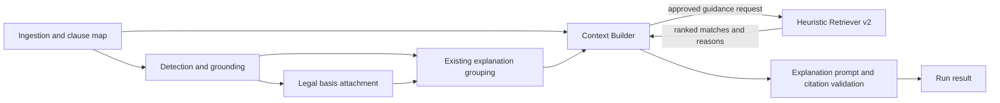

# Heuristic Memory and Context Builder integration

**Proposed first integration:** Build context for each explanation item after risk detection has grounded its findings and legal basis has selected corpus passages. The Context Builder assembles a bounded packet of contract evidence, selected legal passages and approved reasoning guidance. Detection and legal selection keep their current inputs. The current seed contains 18 drafts, so the approved-only path contributes zero heuristic guidance until an authorized reviewer approves entries.

## Current pipeline

| Stage | Code path | Output and boundary |
| --- | --- | --- |
| Upload and orchestration | [`api/analyses.py`](../../backend/application/api/analyses.py) → [`analysis/run.py`](../../backend/application/analysis/run.py) | `POST /analyses` stores the upload and queues `analyze(rid)` as a background task. The run writes stage results to its JSON record. `GET /analyses/{rid}` returns that record. |
| Ingestion | [`ingestion/ingest.py`](../../backend/application/modules/ingestion/ingest.py) → [`structure.py`](../../backend/application/modules/ingestion/structure.py) and [`structure_llm.py`](../../backend/application/modules/ingestion/structure_llm.py) | `ingest()` sniffs and routes TXT, DOCX, DOC and PDF. It checks extracted text and builds a clause map with deterministic segmentation, optionally falling back to a model on low-confidence structure. `Document.text` is cleaned source text. Blocks and clauses carry character offsets into that text. A document can have no clause map. |
| Risk detection | [`detection/pipeline.py`](../../backend/application/modules/detection/pipeline.py) → [`lens.py`](../../backend/application/modules/detection/lens.py) → [`whole_doc.py`](../../backend/application/modules/detection/whole_doc.py) | `run(doc)` builds the closed taxonomy lens. The default `group` mode calls the whole-document detector per taxonomy group. `all` sends all codes together. The document text and taxonomy lens drive the model, with a repair path for rejected results. |
| Evidence validation | [`detection/finding.py`](../../backend/application/modules/detection/finding.py) | `ground()` checks the code, kind and issue. For a present finding it locates the quote in `Document.text`, supporting its existing normalization and ellipsis behavior, and sets offsets and a clause label when available. The party comes from the taxonomy lens. Missing findings have no supporting quote and the gate does not establish document-wide absence. The orchestrator uses only kept findings. |
| Legal basis | [`legal_basis/basis.py`](../../backend/application/modules/legal_basis/basis.py) → [`legal_retrieval/retriever.py`](../../backend/application/modules/legal_retrieval/retriever.py) | `attach()` creates one result per finding in the same order. It combines taxonomy-seeded candidates with corpus search. Default search combines BM25 and dense retrieval and can fall back to BM25. The model picks candidate IDs. Unknown IDs are dropped and `LegalBasis` text comes from the corpus. |
| Explanation | [`explain/explain.py`](../../backend/application/modules/explain/explain.py) | `group()` clusters overlapping present findings, leaves missing findings as separate items and deduplicates attached legal passages by chunk ID. `prompt_for()` renders the item and numbers legal passages `[L1]`, `[L2]`, etc. `check()` parses the response, rejects out-of-range `[Lk]` references, checks a limited pattern for written-out article numbers, and resolves valid references to corpus labels. The run persists the resulting cards and warnings. |

[Heuristic Memory v2](../../backend/application/modules/heuristic_memory/retriever.py) is a standalone local selector. It accepts plain text or an ordered list of explicit clause IDs and text. Its selection records include matched taxonomy hints, trigger and vocabulary phrases, clause IDs, and entry and snapshot versions. The repository contains a [future Context Builder note](heuristic-memory.md), with no implementation or runtime call site for Context Builder or Short-term Memory found in this checkout. The Short-term Memory contract below is a proposal for team agreement.

## Proposed insertion point and sequence



1. Keep the feature behind an internal switch that defaults off. The disabled path invokes the existing explanation code directly. Implement an offline shadow mode first. It records selection metadata and runs the existing explanation unchanged.
2. After `explain.group()`, build one packet per item inside the future explanation adapter. The adapter has access to the original `Document`, the grouped item and the existing attached basis. Treat each item's attached passages as its maximum citation scope.
3. Allocate space for the item and the passages first, then select approved heuristics from a bounded contract window. Pack eligible passages and guidance into the explanation prompt. If nothing qualifies or survives packing, use the existing explanation prompt within the budget. The context-only evaluation arm explicitly exercises packing without guidance. Keep context building local and deterministic. The existing explanation task is the only model call at this stage.
4. Validate the reply against the exact item view used to render it. Persist the existing article citations and evidence offsets through the current output path. Record context diagnostics with the run. For the first rollout, keep the public API response shape stable.
5. Consider a separate pre-detection experiment only after explanation evaluation and human review. A future pre-detection design would have taxonomy lens hints, no grounded finding yet, and a greater risk of biasing findings or suppressing codes. Preserve the closed lens and `ground()` before any output can reach the next stage.

### Retriever inputs and relevance

- **Domain.** Use a server-controlled analysis profile, with `vn_residential_rental` selected only when the configured workflow or validated form selection establishes that scope. If scope is unavailable or unsupported, skip heuristics. The current upload endpoint accepts a file and supplies no explicit domain.
- **Taxonomy.** Use the grouped item's already validated codes and their runtime groups. Pass exact item codes to v2. Supply explicit categories only where an evaluation profile actually has a trusted group hint, since the retriever already derives groups from codes. Code and group hints rank matches today. For the initial pilot, additionally require exact code or matching group and contract evidence connected to the item. Record when that stricter post-filter drops an otherwise valid match. Widen scope only after measuring losses.
- **Present findings.** Take the existing grounded item span as the anchor. Resolve intersecting ingested clauses by offsets and give them run-local IDs derived from stable offsets, since display labels can repeat. Preserve offsets and original text slices. Retrieve from a bounded anchor window, then consider directly referenced clauses in the same document. Use one contiguous ordered window at a time, or an explicitly resolved anchor/reference pair. Do not concatenate unrelated excerpts or treat disjoint windows as neighbors. If a window must be shortened, retain the grounded span and record the actual bounds.
- **Surrounding context.** Rank fully resolved references before adjacent clauses. Bound reference depth to one hop for the initial pilot and bound the number of windows. Ambiguous duplicate labels require a unique resolution before inclusion. Prefer ingestion boundaries, and use source-aligned paragraph or bounded text ranges if there is no reliable clause map. A fallback range gets a provenance marker and offset-derived ID. Ignore neighbors that add no support or contradiction to the issue.
- **Missing findings.** Initially skip heuristic selection for items without a grounded span. Preserve the existing missing-term explanation path. A later bounded search can surface actual related clauses with their own offsets, but neither sparse retrieval nor a remembered summary establishes absence.
- **Post-filter.** Keep matches whose returned clause IDs can be resolved in the current document window and whose evidence touches the anchor or a resolved reference tied to the item. Drop stale, out-of-scope or weak matches. Deduplicate by stable heuristic ID and version. Because filtering happens after selection, request a bounded candidate pool before applying the smaller prompt limit.

## Proposed Python interfaces

These interfaces describe the first implementation. They do not exist in the runtime yet. `LegalBasis`, `Document` and `Item` are existing types. The adapter maps a validated packet to the current explanation item and its basis order. Contract excerpts in the packet are slices of the current `Document.text`.

```python
from dataclasses import dataclass
from typing import Literal, Mapping, Protocol

from application.modules.explain.explain import Item
from application.modules.ingestion.ingest import Document
from application.modules.legal_basis.basis import LegalBasis


@dataclass(frozen=True)
class ContractExcerpt:
    clause_id: str
    label: str | None
    start: int
    end: int
    text: str
    relation: Literal["anchor", "reference", "neighbor"]


@dataclass(frozen=True)
class SelectionReason:
    matched_codes: tuple[str, ...]
    matched_categories: tuple[str, ...]
    matched_triggers: tuple[tuple[str, ...], ...]
    matched_vocabulary: tuple[str, ...]
    matched_clause_ids: tuple[str, ...]


@dataclass(frozen=True)
class ReasoningGuidance:
    heuristic_id: str
    entry_version: str
    knowledge_version: str
    review_status: Literal["approved"]
    reason: SelectionReason
    required_context: tuple[str, ...]
    cross_clause_checks: tuple[str, ...]
    reasoning_checklist: tuple[str, ...]
    expected_behavior: str


@dataclass(frozen=True)
class ContextRequest:
    run_id: str
    document: Document
    domain: str | None
    item: Item


@dataclass(frozen=True)
class PromptBudget:
    context_window: int
    completion_reserve: int
    safety_margin: int
    max_guidance_tokens: int


@dataclass(frozen=True)
class ExplanationContext:
    schema_version: Literal[1]
    contract: tuple[ContractExcerpt, ...]
    legal_passages: tuple[LegalBasis, ...]
    guidance: tuple[ReasoningGuidance, ...]
    estimated_prompt_tokens: int
    dropped_counts: Mapping[str, int]
    status: Literal["ready", "core_over_budget"]


class ContextBuilder(Protocol):
    def build(self, request: ContextRequest, budget: PromptBudget) -> ExplanationContext: ...
```

The builder is constructed with the local, pinned retriever and a token counter supplied by the explanation adapter. The adapter and builder use the same rendering rules to count the final serialized messages. `legal_passages` is the ordered list actually rendered, so its position defines each `[Lk]` reference. Keep this list request-local. The adapter uses the same order for validation and reference resolution. A budgeted item copy can narrow the validation allowlist without discarding the complete attached basis from the run record. Keep contract excerpts and legal passages mechanically distinct from checklist prose. Leave the checklist's legal reference IDs out of the packet.

## Token budgeting and fallback

1. Compute the prompt allowance as the model's configured context window minus completion reserve and a safety margin. The LLM adapter's `max_tokens` currently controls output, so the team needs a separate per-profile context limit. Count instructions, response schema, role framing, item data and section separators as part of the prompt. Prefer the model tokenizer. If only an estimator is available, use a conservative margin and verify it on Vietnamese before enabling the pilot. If the profile limit is unknown, keep the feature off.
2. Reserve the existing item scope, including its grounded quote for present findings, codes and issue details. Then fit attached legal passages in existing deterministic order, preserving passage provenance. Use complete passage text where possible. If a passage will not fit, drop it as a unit and remove it from the prompt-specific allowlist. Avoid partial or generated summaries of legal text in the pilot. Keep the missing-term marker for missing items.
3. Add relevant, source-aligned related clauses, then approved guidance in rank order. An optional excerpt or checklist is an atomic addition. Only include a checklist if its supporting clauses are also present. When several optional items compete, prefer evidence that supports or contradicts the highest-ranked check. Start with a cap of two guidance entries and a separate small token cap, both configurable after measurement. Drop unused optional material and count the rendered prompt again before dispatch.
4. If no legal passage fits, use the existing no-basis instruction and allowlist behavior. If the mandatory item itself does not fit, record an item warning and omit the enhanced explanation call. Use the old explanation path only if its rendered prompt is independently within the budget. A missing, stale or invalid optional memory result degrades to the existing explanation path within the same limit.

For evaluation, record prompt and completion usage where providers report it, estimated tokens otherwise, plus model profile, stage latency, budget drops and how often legal evidence was omitted. Pin corpus, taxonomy and knowledge versions or digests per run. Record matched IDs, entry and snapshot versions, code and clause IDs, and drop reasons. Avoid copying raw contract or checklist text into additional diagnostic logs.

## Evidence, citations and untrusted input

| Risk | Proposed control |
| --- | --- |
| Checklist treated as evidence or law | Render it as curated reasoning questions in a separate data field. Only current-document excerpts can support contract facts. Only attached, rendered corpus passages can support legal claims. Ask the model to state unresolved facts conditionally and omit legal conclusions when the necessary passage is absent. |
| Prompt injection in a contract, model-generated issue or retrieved text | Keep task instructions in trusted prompt code. Serialize and escape all data with fixed field names so arbitrary text cannot close a field or create a role, citation binding or tool call. Treat content as untrusted even when retrieved from an approved source. Use structured output and a deterministic validator. Delimiters alone do not prevent a model from following embedded instructions. |
| Unsupported quotes, absences or wrong-document evidence | Preserve `ground()` and the existing offsets. Validate every extra excerpt against the active document and its digest. Never expand the primary finding span using a heuristic. Missing findings stay marked missing. Neither a neighbor nor a memory summary establishes that a contract term is absent. |
| Hallucinated or wrong-scope citation | Preserve the candidate-ID gate in `basis.pick()` and the existing `explain.check()` checks. Ensure the checker receives exactly the rendered allowlist, including after budget drops. Retain the no-basis path. Add a pilot test and review gate for assertions with plausible-looking but unsupported references. The current article-pattern check and valid IDs do not prove semantic support or applicability. |
| Irrelevant or contradictory context | Enforce bounded windows, taxonomy relevance and provenance. Preserve both conflicting source clauses when useful and in budget. Signal missing evidence or unresolved precedence instead of synthesizing an answer. Keep a weak-match abstention path. |
| Drafts, stale entries and cross-run leaks | Use the approved-only selector and validate review status at packet boundaries. Pin the knowledge snapshot for each run. Scope any document index or cache to the current analysis and document digest. Reject foreign or stale references. Never write analysis text into the shared heuristic knowledge base. |

**Example for a team presentation.** A grounded finding concerns a deposit refund due after handover. The builder can include the refund quote and a referenced key-return clause. An approved checklist may ask which event starts the clock and who signs the record. The explanation can distinguish the stated contract conditions from unresolved facts. Any legal statement must still be supported by a passage attached to this item through the legal basis stage.

## Integration tests and evaluation

Use a synthetic contract and stubbed model and legal retrieval responses in integration tests. Start with the existing [analysis tests](../../backend/tests/test_analysis.py), [grounding tests](../../backend/tests/test_detect_finding.py), [legal basis tests](../../backend/tests/test_legal_basis.py), [explanation tests](../../backend/tests/test_explain.py) and [heuristic tests](../../backend/tests/test_heuristic_memory.py). These are proposed test additions.

| Integration test | Expected result |
| --- | --- |
| Switch off, empty approved set, unknown domain, and retrieval failure | Existing detection findings and attached bases stay identical. Disabled and empty-guidance paths match the baseline prompt unless testing the separate context-only condition. Recoverable optional failures are visible in diagnostics. |
| Present finding in TXT or DOCX with related clauses | Excerpts map to unchanged offsets. Duplicate headings resolve only when unambiguous. Explicit reference and adjacency tests keep unrelated events apart. A document with no clause map still has source-aligned fallback excerpts. |
| Missing finding and ungrounded present candidate | Missing item receives no heuristic in the initial policy. An ungrounded present candidate never reaches context building. |
| Small or exhausted budget | Deterministic item order, no extra model call and no over-budget dispatch. Guidance is dropped if its evidence is missing. Removed legal passages are unavailable for citation. |
| Unknown legal candidate, forged `[Lk]`, empty basis and embedded instructions | Candidate-ID and explanation validation reject invalid references as today. Contract text cannot create a trusted instruction, approved heuristic or new legal entry. Include a good case that resolves the same label after budget filtering. |
| Replay, concurrent runs, cache invalidation | Same inputs and versions produce the same packet. A different run cannot read the first run's snippets, stale offsets or citation mapping. Knowledge or document revision invalidates cached results. |
| Scope and ranking | Taxonomy hints come from validated item codes. Test a related clause with several lexical matches, a weaker irrelevant match, HO-21-style nested negation, paraphrases and cross-clause evidence. Check selection reasons and abstention against authorized review labels. |

**Evaluation plan.** First reproduce the [v2 comparison](heuristic-memory-retriever-v2.md), which used text-only retrieval and provisional labels. Include HO-21, paraphrase misses and cross-clause errors as regression checks. Build a separate human-reviewed suite of contract-level windows with annotated anchor spans, relationship links, expected heuristic relevance, cases where the builder should abstain, and legal-support judgments. Compare approved-only retrieval on the same inputs using Precision, Recall and Hit at K=1/3/5, expected-empty accuracy and results by scenario type. Record the eligible approved set and report coverage separately so an empty approved set cannot be mistaken for a useful pilot.

Run a paired comparison with the same contracts, unchanged grounded findings and legal basis attachments, model and sampling settings. Compare the current explanation, budgeted contract/legal context without guidance, and the same policy with approved guidance. Where budget packing changes which material is visible, report the difference and review it alongside the guidance effect. Blind reviewers to the condition and score clause accuracy, identification of unresolved facts, useful recommendations, legal entailment and unsupported assertions or citations. Report regressions per item, token and latency change, and results for no-law and no-match cases. Stop promotion on any newly accepted ungrounded finding, invalid citation or cross-run leak. Agree on quality and cost thresholds before the pilot. Synthetic gains alone provide no deployment evidence.

## Team ownership and dependencies

| Owner | Implementation tasks |
| --- | --- |
| Long-term Memory | Own the versioned heuristic snapshot, authorized review workflow, v2 selector and match explanations. Provide an approved-only adapter, output schema fixtures and an independently reviewed retrieval evaluation. Resolve or document HO-21 and holdout misses before proposing approved candidates for the pilot. Keep heuristic guidance separate from legal authority. |
| Short-term Memory | Own per-run context lookup, if that is the team's chosen scope. Provide an optional in-process source of clause references keyed by run and document digest. Return IDs and source offsets that can be rehydrated from the active document. Define retention and deletion, cache invalidation and run isolation. Keep this interface optional so the initial builder can operate on the in-memory `Document`. |
| Joint, with pipeline and legal owners | Agree on the shared clause identity and offset convention, schema ownership, rendering and budget policy, stage handoff, and evaluation criteria. Assign a single owner to the Context Builder and prompt adapter before implementation. The legal and pipeline owners verify that citation allowlists, evidence checks and public response contracts survive the pilot. |

The likely conflicts are duplicate clause indexing, incompatible context schemas, competing prompt budgets and stale session summaries. Resolve them by treating ingestion's cleaned document and offsets as canonical, using one shared Context Builder for packing, and making Short-term Memory a provider of candidate references. Rehydrate references from the current document and reject stale hashes. Short-term Memory should neither persist global heuristics nor bypass the builder to append prompt text. Long-term Memory should avoid retaining per-contract state. The student teams can implement and test their boundaries independently once they agree on IDs and fixtures. The first pilot has no dependency on persistent Short-term Memory.
